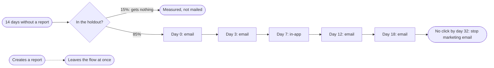

# LMM Engine

**Describe a lifecycle flow in one sentence. Get back a plan your team can launch: who gets it, every email and text written in your platform's own code, the timing, a legal and inbox check, and a holdout that shows what the flow really earned.**

- Works for software companies and online stores, with Klaviyo, HubSpot, Braze, Customer.io, Iterable and Salesforce Marketing Cloud.
- Every morning it tells you what to fix and what is most worth building next, with an estimated revenue range for each.
- It never sends a message or changes your accounts unless you approve it.
- Free and open source. Runs inside Claude, or from a terminal.

---

## What you get

You type:

> *"a 5-touch win-back for users who completed onboarding but haven't created a report in 14 days"*

It returns a plan like this one, made for Ridgeview, the sample B2B reporting tool in this repository, which emails from Customer.io ([the full plan](examples/brands/ridgeview_saas/runs/winback_14d/plan.md)):

**Who gets it**

| | |
|---|---|
| **Enters** | Finished onboarding, then went 14 days without creating a report. Once per lapse, so nobody enters twice for the same quiet stretch |
| **Never enters** | No consent, on your suppression list, or an internal or test account |
| **Leaves** | The moment they create a report again, checked before every message |
| **How many** | About 28 people a month. 17.5% come back on their own with no emails, so that is the number the flow has to beat |

It also writes the query that finds these people every day, for PostgreSQL, Snowflake and BigQuery.

**The flow**

**The messages**, two versions of each to test, written in Customer.io's template code:

| When | The job | Version A | Version B |
|---|---|---|---|
| Day 0, email | Remind them what they had | Your last report is one click away | This week's numbers are ready to pull |
| Day 3, email | Remove the reason they stopped | The two-minute way to build a report | Want me to build your first report? |
| Day 7, in-app | Show what is new | New: start a report from a template | Your data sources are still syncing |
| Day 12, email | Show how others use it | How our support team builds its weekly report | Have your report come to you |
| Day 18, email | Ask before mailing more | Should I keep sending these? | Last note from me about reports |

That last email is deliberate: people who ignore a whole win-back are the ones who mark it as spam, so it asks, and stops mailing the ones who don't answer.

**Before you build**, the plan also lists:
- everything it had to assume, for you to confirm;
- a check against email and texting law in the six regions in Ridgeview's customer list, and the inbox rules;
- step-by-step build instructions in Customer.io's own terms;
- the truth about measurement. At 28 people a month, a holdout would need years to prove a lift, so it keeps one anyway and labels every result "directional" instead of promising a date it cannot keep.

**It works the same for an online store.** For the sample coffee store on Shopify and Klaviyo, *"a 3-touch abandoned cart flow with email and SMS"* returns a flow that shows each person's cart from Shopify's own event. Its buttons go back to that checkout, and the second touch is a text for people with consent, or an email for everyone else, answering the question that stops coffee buyers: which grind? ([the full plan](examples/brands/northfield_dtc/runs/cart_abandon/plan.md))

---

## Every morning

It reads your data and tells you what matters today. Here is a morning check on Ridgeview, trimmed:

> **Fix first: sunset the unengaged before scaling anything.** 62% of the people Ridgeview can email got 5 or more emails in six months and clicked none. That puts the sending gate at RED: mail more and the rest of the list starts landing in spam.
>
> **1. Win-back at 14 days without a report.** 28 people a month reach it, and no live flow catches them. The monthly newsletter does not do the job: 85% of its sends to these people landed more than a week after they went quiet. **About $41 to $103 a month.** Effort: medium.
>
> **2. Activation flow for new signups, aimed at inviting a teammate.** Only 5.3% of new signups create a report within 14 days on their own, and the biggest drop in onboarding is the invite-a-teammate step, where a third of people stop. **About $13 to $33 a month.** Effort: medium.

The revenue ranges are small because the sample company is small (400 users); on your data they scale with your volume and your revenue per customer. The audience sizes and baselines are measured from your data; only the lift is an assumption, and it says so. Each idea comes with the one step that turns it into a full plan.

It also checks that your email still reaches the inbox:
- your domain's authentication records (SPF, DKIM, DMARC);
- each day's bounces, blocks and spam complaints by mailbox provider;
- how many people on your list have stopped engaging.

When something breaks, the flag comes up the next morning, not in next month's report.

---

## It tells you what really worked

Email platforms credit a flow with every purchase that followed it, including the ones that would have happened anyway. Every plan here keeps a holdout group that gets nothing, so you can see the difference.

In the repository's worked example, the platform credited a win-back flow with **$41,900**. Measured against its holdout, the flow actually added about **$15,880**, and the engine says plainly that even that is not yet statistically certain. A team reading only the platform's number would scale that flow; this one would keep testing it.

---

## What you can ask it

| Ask… | You get |
|---|---|
| "plan a 5-touch win-back for users who haven't created a report in 14 days" | The full plan above |
| "plan an activation flow for new signups who haven't invited a teammate" | A plan aimed at the onboarding step where most people stall |
| "make it 4 touches" · "add in-app" · "go with version B" | Only that part changes; approved copy stays approved |
| "when do customers stop using the product, by plan?" | Where retention drops and where it levels off, for each plan |
| "what are my top 3 priority builds today and why?" | What to fix first, then the builds most worth doing, with revenue ranges |
| "what broke overnight?" | The morning check |
| "check deliverability for example.com" | Your domain's records, a GREEN, AMBER or RED verdict, and the exact fixes |
| "who should we stop emailing?" | The people who never engage, as a list you can undo |
| "did the win-back flow actually work?" | What the platform credited, what the flow really added, and how sure that is |
| "could one person get too many emails a week from all our flows?" | Every live flow checked together against your frequency limits |
| "plan a 3-touch abandoned cart flow with email and SMS" | The store version: the cart from your store's own event, and a link back to that checkout |

It plans ten kinds of flow: welcome, activation, win-back, abandoned cart, browse abandonment, post-purchase, replenishment, failed payment, trial conversion and sunset. It refuses anything else by name instead of bending it into the nearest one. More questions, by cadence: [the question bank](docs/QUESTION_BANK.md).

---

## Works with

| | |
|---|---|
| **Email and SMS platforms** | Klaviyo, HubSpot, Braze, Customer.io, Iterable, Salesforce Marketing Cloud |
| **Your data** | Exports from Shopify, Klaviyo, Stripe, HubSpot and Customer.io, Google Analytics 4, Segment and RudderStack events, or your warehouse (BigQuery, Snowflake, PostgreSQL) |
| **Inside Claude** | Uses the connectors already in your Claude account; works from exports for anything without one ([details](CONNECTORS.md)) |

---

## You stay in control

- **Nothing reaches your platform without your approval.** It writes plans, copy and build instructions. With your explicit approval it can create the flow in Klaviyo, HubSpot or Salesforce Marketing Cloud; the flow starts switched off, and the templates and segments created with it send nothing on their own. Your platform sends to customers only after a person turns the flow on.
- **Every number says where it came from:** measured from your data, supplied by you, estimated, or unknown. Missing data lowers confidence; it is never guessed.
- **No overclaiming.** A result too small to prove is labeled "directional", never presented as proof.
- **The legal check is a checklist with sources, not legal advice.** It blocks clear violations and turns everything else into questions for your counsel.
- **Your data stays yours.** It reads through connectors you already authorized, or files you give it. Nothing goes to the author of this repository.

---

## Try it

**In Claude (no code).** You need a paid Claude plan; it works best in the Claude desktop app with a working folder, or in Claude Code.
1. Open **Customize → Plugins → Add marketplace**, enter `kyle-olmstead/lifecycle-marketing-claude-engine`, and add the **lifecycle-engine** plugin.
2. Say **"set up the lifecycle engine."** It finds the tools you have connected and records your platform, brand and sending rules for every plan to use.
3. Describe a flow, or ask "what are my top 3 priority builds today and why?"

**From a terminal.** Clone, install and run your first plan on a sample brand in about fifteen minutes: [QUICKSTART.md](QUICKSTART.md).

Two fictional sample companies come with their data, so you can see real output before connecting anything: a B2B reporting tool on Customer.io, and a coffee store on Shopify and Klaviyo.

---

## What it needs from you

| Make sure you have… | Because |
|---|---|
| **The one action that means a customer is getting value** (for software, the key action, like "created a report"; for a store, an order) | Every flow is built around it: who enters, when they leave, how success is measured |
| **Consent recorded per person and channel, and each person's country** | Who may be emailed or texted, and which laws apply, come from these |
| **Your sending domain and postal address** | The inbox checks need the domain; US law needs the address in every marketing email |

---

## Go deeper

| If you want… | Read |
|---|---|
| A marketer's walkthrough: reading a plan, revising it, who writes the copy | [docs/quickstart_for_marketers.md](docs/quickstart_for_marketers.md) |
| Every flow, with its trigger, timing and holdout | [docs/FLOW_LIBRARY.md](docs/FLOW_LIBRARY.md) |
| The business case, with every number explained and a calculator | [docs/ROI_MEMO.md](docs/ROI_MEMO.md) |
| Every command | [docs/COMMANDS.md](docs/COMMANDS.md) |
| How it works, the daily job, the repository and what the tests prove | [docs/UNDER_THE_HOOD.md](docs/UNDER_THE_HOOD.md) |
| What changed in each version | [CHANGELOG.md](CHANGELOG.md) |

---

## Words used here

| Term | Meaning |
|---|---|
| **Lifecycle marketing** | Messages sent automatically based on what each customer does, rather than on a calendar |
| **Flow** | One automated sequence of messages, such as a welcome series or a win-back |
| **Holdout** | A randomly chosen group that gets no messages, so the difference shows what the flow truly caused |
| **Credited vs real lift** | What the platform credits a flow with, versus what the flow actually added |
| **Deliverability** | Whether email reaches the inbox, rather than spam or nowhere |
| **Sending gate** | The engine's GREEN, AMBER or RED verdict on whether it is safe to send more |
| **SPF, DKIM, DMARC** | The three records that prove your email really comes from you; mailbox providers require all three |
| **Unengaged / sunset** | People who keep receiving email and never click; sunsetting stops marketing email to them until they engage again |

---

## FAQ

**Does it need an API key?** No. In Claude it uses the connectors in your account. From a terminal, a Claude API key lets it write the copy; without one it uses its own starter copy.

**Our list is small. Is it still useful?** Yes, and it says so honestly: a small list can't prove a lift quickly, so it tells you how long it would take instead of inventing a result.

**Has it run at a real company?** Not yet. The examples use fictional companies, and the revenue figures are modeled, not customer results.

**What does it cost?** The software is free (Apache 2.0). You need a paid Claude plan.

---

## License

Apache 2.0: use it, change it, ship it. Examples use fictional companies on domains reserved for documentation (`example.com`, `.example`, `.test`). Improvements to the rules, prompts and platform dialects are the most valuable pull requests.
