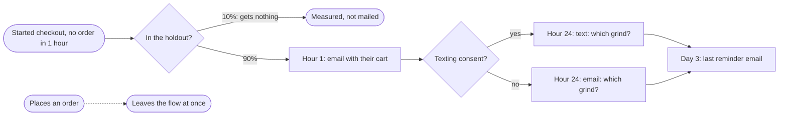

# LMM Engine

**Describe a lifecycle flow in one sentence. Get back a plan your team can launch: who gets it, every email and text written in your platform's own code, the timing, a legal and inbox check, and a holdout that shows what the flow really earned.**

- Works for online stores and software companies, with Klaviyo, HubSpot, Braze, Customer.io, Iterable and Salesforce Marketing Cloud.
- Every morning it tells you what to fix and what is most worth building next, with an estimated revenue range for each.
- It never sends a message or changes your accounts unless you approve it.
- Free and open source. Runs inside Claude, or from a terminal.

---

## What you get

You type:

> *"a 3-touch abandoned cart flow with email and SMS"*

It returns a plan like this one, made for the sample coffee store in this repository ([the full plan](examples/brands/northfield_dtc/runs/cart_abandon/plan.md)):

**Who gets it**

| | |
|---|---|
| **Enters** | Started checkout and did not order within 1 hour |
| **Never enters** | No consent, on your suppression list, or a test account |
| **Leaves** | The moment they place an order |
| **How many** | About 351 people a month. 31% order anyway with no emails, so that is the number the flow has to beat |

**The flow**

**The messages**, two versions of each to test, written in Klaviyo's template code with the cart pulled from Shopify's own event:

| When | Version A | Version B |
|---|---|---|
| Hour 1, email | Your coffee is still in your cart | Still in your cart: *(the item's name)* |
| Hour 24, text or email | Not sure which grind to pick? Reply with how you brew and we will tell you. | Shipping shows at checkout before you pay, so there are no surprises. |
| Day 3, email | Last reminder about your cart | Still want *(the item's name)*? |

**Before you build**, the plan also lists:
- everything it had to assume, for you to confirm;
- a check against email and texting law where your customers live, and the inbox rules;
- step-by-step build instructions for your platform;
- when the holdout can prove a result. Here that is about 15 months at this volume, so it says to read results as directional until then.

The same works for a software company. "A 5-touch win-back for users who haven't created a report in 14 days" gets the same kind of plan for the sample reporting tool ([the full plan](examples/brands/ridgeview_saas/runs/winback_14d/plan.md)).

---

## Every morning

It reads your data and tells you what matters today. Here is a morning check on the sample coffee store, trimmed:

> **Fix first: data stopped arriving.** The newest event is 5 days old, so the cart and welcome flows are sending nothing until the sync is fixed.
>
> **1. Post-purchase flow: turn first orders into second orders.** 83 new customers a month place a first order; 24.9% order again within 60 days with nothing sent. **About $60 to $150 a month.** Effort: small.
>
> **2. Win-back at 60 days since the last order.** 102 people a month reach it, and no live flow catches them. **About $48 to $119 a month.** Effort: medium.
>
> **Also today:** 23% of your list is unengaged. Plan a re-permission email and stop mailing the rest.

The audience sizes and baselines are measured from your data; only the lift is an assumption, and it says so. Each idea comes with the one step that turns it into a full plan.

It also checks that your email still reaches the inbox:
- your domain's authentication records (SPF, DKIM, DMARC);
- each day's bounces, blocks and spam complaints by mailbox provider;
- how many people on your list have stopped engaging.

When something breaks, the flag comes up the next morning, not in next month's report.

---

## It tells you what really worked

Email platforms credit a flow with every purchase that followed it, including the ones that would have happened anyway. Every plan here keeps a holdout group that gets nothing, so you can see the difference.

In the repository's worked example, the platform credited a win-back flow with **$41,900**. Measured against its holdout, the flow actually added about **$15,880**, and the engine says plainly that even that is not yet statistically certain. A team reading only the platform's number would scale that flow; this one would keep testing it.

---

## What you can ask it

| Ask… | You get |
|---|---|
| "plan a 3-touch abandoned cart flow with email and SMS" | The full plan above |
| "make it 4 touches" · "add SMS" · "go with version B" | Only that part changes; approved copy stays approved |
| "what are my top 3 priority builds today and why?" | What to fix first, then the builds most worth doing, with revenue ranges |
| "what broke overnight?" | The morning check |
| "check deliverability for example.com" | Your domain's records, a GREEN, AMBER or RED verdict, and the exact fixes |
| "who should we stop emailing?" | The people who never engage, as a list you can undo |
| "did the win-back flow actually work?" | What the platform credited, what the flow really added, and how sure that is |
| "could one person get too many emails a week from all our flows?" | Every live flow checked together against your frequency limits |

It plans ten kinds of flow: welcome, activation, win-back, abandoned cart, browse abandonment, post-purchase, replenishment, failed payment, trial conversion and sunset. It refuses anything else by name instead of bending it into the nearest one. More questions, by cadence: [the question bank](docs/QUESTION_BANK.md).

---

## Works with

| | |
|---|---|
| **Email and SMS platforms** | Klaviyo, HubSpot, Braze, Customer.io, Iterable, Salesforce Marketing Cloud |
| **Your data** | Exports from Shopify, Klaviyo, Stripe, HubSpot and Customer.io, Google Analytics 4, Segment and RudderStack events, or your warehouse (BigQuery, Snowflake, PostgreSQL) |
| **Inside Claude** | Uses the connectors already in your Claude account; works from exports for anything without one ([details](CONNECTORS.md)) |

---

## You stay in control

- **Nothing reaches your platform without your approval.** It writes plans, copy and build instructions. With your explicit approval it can create the flow in Klaviyo, HubSpot or Salesforce Marketing Cloud; the flow starts switched off, and the templates and segments created with it send nothing on their own. Your platform sends to customers only after a person turns the flow on.
- **Every number says where it came from:** measured from your data, supplied by you, estimated, or unknown. Missing data lowers confidence; it is never guessed.
- **No overclaiming.** A result too small to prove is labeled "directional", never presented as proof.
- **The legal check is a checklist with sources, not legal advice.** It blocks clear violations and turns everything else into questions for your counsel.
- **Your data stays yours.** It reads through connectors you already authorized, or files you give it. Nothing goes to the author of this repository.

---

## Try it

**In Claude (no code).** You need a paid Claude plan; it works best in the Claude desktop app with a working folder, or in Claude Code.
1. Open **Customize → Plugins → Add marketplace**, enter `kyle-olmstead/lifecycle-marketing-claude-engine`, and add the **lifecycle-engine** plugin.
2. Say **"set up the lifecycle engine."** It finds the tools you have connected and records your platform, brand and sending rules for every plan to use.
3. Describe a flow, or ask "what are my top 3 priority builds today and why?"

**From a terminal.** Clone, install and run your first plan on a sample brand in about fifteen minutes: [QUICKSTART.md](QUICKSTART.md).

Two fictional sample companies come with their data, so you can see real output before connecting anything: a coffee store on Shopify and Klaviyo, and a reporting tool on Customer.io.

---

## What it needs from you

| Make sure you have… | Because |
|---|---|
| **The one action that means a customer is getting value** (for a store, an order; for software, the key action, like "created a report") | Every flow is built around it: who enters, when they leave, how success is measured |
| **Consent recorded per person and channel, and each person's country** | Who may be emailed or texted, and which laws apply, come from these |
| **Your sending domain and postal address** | The inbox checks need the domain; US law needs the address in every marketing email |

---

## Go deeper

| If you want… | Read |
|---|---|
| A marketer's walkthrough: reading a plan, revising it, who writes the copy | [docs/quickstart_for_marketers.md](docs/quickstart_for_marketers.md) |
| Every flow, with its trigger, timing and holdout | [docs/FLOW_LIBRARY.md](docs/FLOW_LIBRARY.md) |
| The business case, with every number explained and a calculator | [docs/ROI_MEMO.md](docs/ROI_MEMO.md) |
| Every command | [docs/COMMANDS.md](docs/COMMANDS.md) |
| How it works, the daily job, the repository and what the tests prove | [docs/UNDER_THE_HOOD.md](docs/UNDER_THE_HOOD.md) |
| What changed in each version | [CHANGELOG.md](CHANGELOG.md) |

---

## Words used here

| Term | Meaning |
|---|---|
| **Lifecycle marketing** | Messages sent automatically based on what each customer does, rather than on a calendar |
| **Flow** | One automated sequence of messages, such as a welcome series or a win-back |
| **Holdout** | A randomly chosen group that gets no messages, so the difference shows what the flow truly caused |
| **Credited vs real lift** | What the platform credits a flow with, versus what the flow actually added |
| **Deliverability** | Whether email reaches the inbox, rather than spam or nowhere |
| **Sending gate** | The engine's GREEN, AMBER or RED verdict on whether it is safe to send more |
| **SPF, DKIM, DMARC** | The three records that prove your email really comes from you; mailbox providers require all three |
| **Unengaged / sunset** | People who keep receiving email and never click; sunsetting stops marketing email to them until they engage again |

---

## FAQ

**Does it need an API key?** No. In Claude it uses the connectors in your account. From a terminal, a Claude API key lets it write the copy; without one it uses its own starter copy.

**Our list is small. Is it still useful?** Yes, and it says so honestly: a small list can't prove a lift quickly, so it tells you how long it would take instead of inventing a result.

**Has it run at a real company?** Not yet. The examples use fictional companies, and the revenue figures are modeled, not customer results.

**What does it cost?** The software is free (Apache 2.0). You need a paid Claude plan.

---

## License

Apache 2.0: use it, change it, ship it. Examples use fictional companies on domains reserved for documentation (`example.com`, `.example`, `.test`). Improvements to the rules, prompts and platform dialects are the most valuable pull requests.
