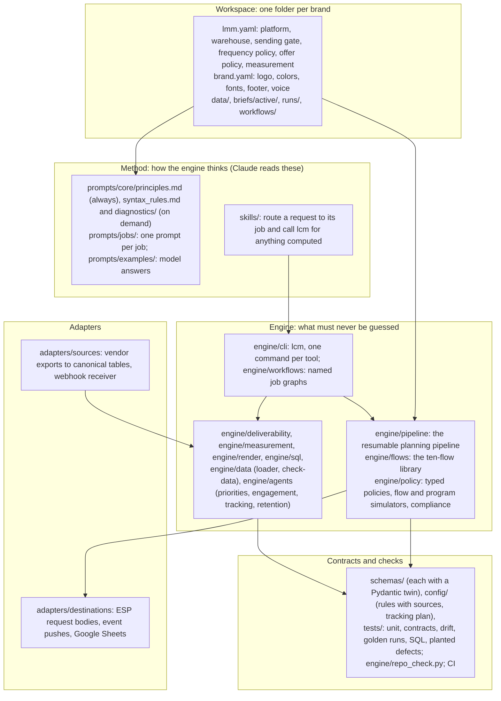
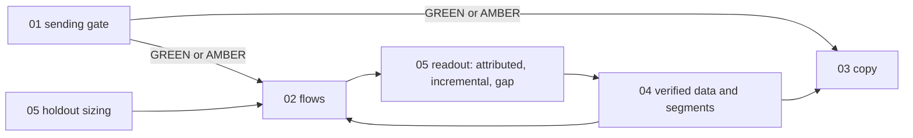

# Architecture

> **In plain English.** The engine is a set of instructions for Claude plus a few small programs.
> The instructions tell Claude how a senior lifecycle strategist and a senior CRM engineer would
> work a problem: what to check first, what to refuse, what a finished deliverable looks like. The
> programs do the parts that must never be guessed: parsing DNS records and email headers, counting
> SMS segments, sizing experiments, checking template and SQL syntax. Claude reasons; the programs
> compute; continuous integration checks that the engine's own examples follow its own rules.

## 1. Layers

| Layer | Files | Responsibility |
|---|---|---|
| Workspace | `lmm.yaml`, `brand.yaml` (`lcm init` writes both; `schemas/workspace.schema.json`, `schemas/brand_kit.schema.json`) | Everything the engine knows about one brand, in files code reads. Every brief planned there inherits it; nothing is guessed that the workspace states. |
| Method | `prompts/`, `skills/` | How a senior lifecycle strategist and a senior CRM engineer work a problem: principles read once per conversation, syntax rules and diagnostics read when the job needs them, one prompt per job. Skills route a request and call `lcm` for the computed parts. |
| Engine | `engine/` | One brief in, a checked plan out (the pipeline: analyst, strategist, architect, copywriter, experiment, QA, compliance), plus every deterministic tool: deliverability, measurement, rendering, SQL, data checks, the simulators. `lcm` exposes each as a command. |
| Adapters | `adapters/` | The edges: vendor exports and webhooks in; ESP request bodies, event pushes and Sheets out. |
| Contracts and checks | `schemas/`, `config/`, `tests/`, `engine/repo_check.py`, `engine/docs_gen.py`, `.github/workflows/ci.yml` | Machine-readable contracts held to their Pydantic twins; every example in the repository checked against the rules the engine imposes; the prose checked against the code. |

## 2. Job dependencies

Work flows in one direction. A job never designs past a gate an upstream job has not cleared.

- **Gate before sending.** 02 and 03 refuse to design sending work on a RED gate and limit AMBER to
  engaged segments.
- **Data before segments.** Any segment a flow uses comes from 04 with its fill rates verified.
- **Measurement before launch.** 05 sizes the holdout at spec time; 05 reads the result later.

## 3. Why the tools exist

Language models are good at judgment and bad at counting, parsing and arithmetic under pressure.
The engine draws the line explicitly:

| Claude decides | A tool computes |
|---|---|
| the root cause of an inbox problem | SPF lookup counts, DKIM key sizes, alignment, the gate verdict (`lcm deliverability check`) |
| whether to warm and how fast in principle | a ladder that cannot use the unengaged tier or exceed engaged capacity (`lcm warmup`) |
| which effect is worth detecting | sample sizes, intervals, sample ratio checks, design effects, stopping boundaries (`lcm size`, `lcm cluster`, `lcm sequential`) |
| what the SMS should say | encoding and segment count on the worst-case rendering (`lcm sms`) |
| what the email should say | whether the template parses in its dialect, every token has a fallback, and the brand kit's colors are readable (`lcm lint`, `lcm brand check`) |
| which segments to build | whether the SQL parses in its dialect and runs on fixtures (`lcm sql-check`) |
| which flows can run together | every live flow against one frequency policy and collision rule (`lcm simulate --program`) |
| whether the data can be trusted | missing, late, malformed, future-dated or orphaned rows, column by column (`lcm check-data`) |
| what to sync to the ESP | request bodies within the vendor's batch and size limits (`lcm sync`, `lcm events`) |

## 4. Two ways to run it

**Plugin mode.** Install the repository as a Claude plugin (see the README). The skills in
`skills/` load the right job prompt for a request, read the user's connected platforms where a Claude
connector exists, and run `lcm` when code execution is available.

**Terminal mode.** `lcm` runs every job directly, in a workspace (`lcm init`), from a sentence or a subcommand.

**Paste-in mode.** In any Claude surface: paste `prompts/core/principles.md`, then the workspace's `lmm.yaml`,
then the job prompt. Everything still works except running the tools; the engine labels such output "unchecked".

## 5. What is verified, and what is not

| Claim | Verified by | Not verified |
|---|---|---|
| Every SQL example parses in its dialect | sqlglot in CI | a compile against a live Snowflake or BigQuery account |
| PostgreSQL examples return correct rows | execution on DuckDB fixtures in CI | execution on a production PostgreSQL |
| Snowflake and BigQuery RFM and LTV versions match PostgreSQL | transpiled to DuckDB; key output columns compared for every customer (RFM: segment and R, F, M scores) and every cohort and period (LTV: observed customers, cumulative LTV) | other columns; the warehouses' own optimizers and edge-case semantics |
| Liquid, Klaviyo and HubL templates are syntactically valid | python-liquid, Django and Jinja2 parsers | platform-only tags beyond those the linter knows; rendering in each ESP |
| AMPscript examples are structurally sound | delimiter, block and string checks | AMPscript function semantics |
| Statistics are correct | tests pin reference values: sample sizes from the standard two-proportion formula, Newcombe intervals checked against statsmodels and chi-square tails against scipy when written | the suite does not import either library, so a change in those libraries is not detected |
| DNS and header analysis | unit tests on fixtures | live DNS (the tool never queries the network) |
| API endpoints and limits | read from vendor documentation in October 2026 | that they have not changed since |

## 6. Extending it

- **A new job prompt**: copy the structure of an existing one in `prompts/jobs/` (front matter, role, inputs,
  protocol, output format, guardrails), put any worked example in `prompts/examples/`, route to it from the skill that
  owns the job, and give every example block a dialect so `repo_check.py` tests it.
- **A new event**: add its `$defs` schema and its `x-tracking-plan` line (naming what it unlocks)
  to `config/tracking_plan.json`, and a valid and an invalid example to `examples/events/`.
- **A new platform dialect**: add it to `engine/render/template_lint.py` with a real parser where one
  exists, a fallback rule, and its unsubscribe and address tokens; then add a column to the dialect
  tables in `docs/LIQUID_CHEATSHEET.md` and the copy prompts.

## 7. The pipeline

The pipeline runs the method as code for one flow at a time: the cohort analyst applies the data discipline, the
campaign architect the flow library's rules, the copywriter the copy rules through the template linter and the
brand kit, and the experimentation agent the sizing through `engine/measurement/`. Its stages, contracts,
verification and extension points are in [`architectural_overview.md`](architectural_overview.md).
