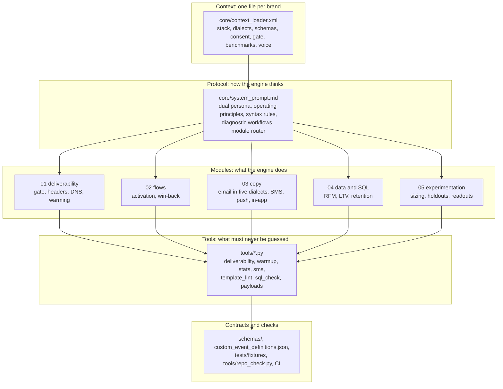
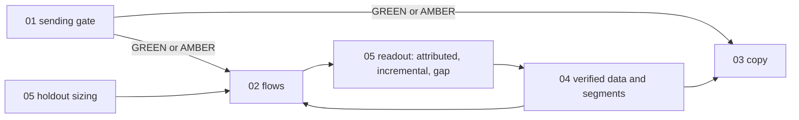

# Architecture

> **In plain English.** The engine is a set of instructions for Claude plus a few small programs.
> The instructions tell Claude how a senior lifecycle strategist and a senior CRM engineer would
> work a problem: what to check first, what to refuse, what a finished deliverable looks like. The
> programs do the parts that must never be guessed: parsing DNS records and email headers, counting
> SMS segments, sizing experiments, checking template and SQL syntax. Claude reasons; the programs
> compute; continuous integration checks that the engine's own examples follow its own rules.

## 1. Layers

| Layer | Files | Responsibility |
|---|---|---|
| Context | `core/context_loader.xml` | Everything a session needs about one brand, labeled by how it is known (LIVE PULL, SUPPLIED, ESTIMATE). Filled once, reused every session. |
| Protocol | `core/system_prompt.md` | Identity (strategist plus engineer), the ten operating principles, zero-tolerance syntax rules, standard diagnostic workflows, and the router that picks a module. |
| Modules | `modules/01_*` to `modules/05_*` | One prompt per job, each with explicit input variables, preconditions, a step protocol, an output format, a worked example and guardrails. |
| Tools | `tools/*.py` | Deterministic computation, standard library plus a few parsers. No network, no API keys. |
| Contracts | `schemas/`, `modules/02_*/schemas/` | JSON Schemas for event payloads and flow specifications, so outputs can be validated by machine. |
| Checks | `tools/repo_check.py`, `tests/`, `.github/workflows/ci.yml` | Every SQL, template, JSON and XML example in the repository is checked against the rules the engine imposes on Claude. |
| Teammate (2.1) | `agents/`, `scripts/`, `config/`, `briefs/` | One brief in, a checked plan out: four agents run the modules as code, a simulator dry-runs the flow, and a daily audit watches the cohort. See [`architectural_overview.md`](architectural_overview.md). |

## 2. Module dependencies

Work flows in one direction. A module never designs past a gate an upstream module has not cleared.

- **Gate before sending.** 02 and 03 refuse to design sending work on a RED gate and limit AMBER to
  engaged segments.
- **Data before segments.** Any segment a flow uses comes from 04 with its fill rates verified.
- **Measurement before launch.** 05 sizes the holdout at spec time; 05 reads the result later.

## 3. Why the tools exist

Language models are good at judgment and bad at counting, parsing and arithmetic under pressure.
The engine draws the line explicitly:

| Claude decides | A tool computes |
|---|---|
| the root cause of an inbox problem | SPF lookup counts, DKIM key sizes, alignment, the gate verdict (`deliverability.py`) |
| whether to warm and how fast in principle | a ladder that cannot use the unengaged tier or exceed engaged capacity (`warmup.py`) |
| which effect is worth detecting | sample sizes, intervals, sample ratio checks (`stats.py`) |
| what the SMS should say | encoding and segment count on the worst-case rendering (`sms.py`) |
| what the email should say | whether the template parses in its dialect and every token has a fallback (`template_lint.py`) |
| which segments to build | whether the SQL parses in its dialect and runs on fixtures (`sql_check.py`) |
| what to sync to the ESP | request bodies within the vendor's batch and size limits (`payloads.py`) |

## 4. Two ways to run it

**Plugin mode.** Install the repository as a Claude plugin (see the README). The skills in
`skills/` load the right module for a request, read the user's connected platforms where a Claude
connector exists, and run the tools when code execution is available.

**Paste-in mode.** In any Claude surface: paste `core/system_prompt.md`, then the filled context
file, then the module prompt for the job. Everything still works except running the tools; the
engine labels such output "unchecked".

## 5. What is verified, and what is not

| Claim | Verified by | Not verified |
|---|---|---|
| Every SQL example parses in its dialect | sqlglot in CI | a compile against a live Snowflake or BigQuery account |
| PostgreSQL examples return correct rows | execution on DuckDB fixtures in CI | execution on a production PostgreSQL |
| Snowflake and BigQuery RFM and LTV versions match PostgreSQL | transpiled to DuckDB; key output columns compared for every customer (RFM: segment and R, F, M scores) and every cohort and period (LTV: observed customers, cumulative LTV) | other columns; the warehouses' own optimizers and edge-case semantics |
| Liquid, Klaviyo and HubL templates are syntactically valid | python-liquid, Django and Jinja2 parsers | platform-only tags beyond those the linter knows; rendering in each ESP |
| AMPscript examples are structurally sound | delimiter, block and string checks | AMPscript function semantics |
| Statistics are correct | tests pin reference values: sample sizes from the standard two-proportion formula, Newcombe intervals checked against statsmodels and chi-square tails against scipy when written | the suite does not import either library, so a change in those libraries is not detected |
| DNS and header analysis | unit tests on fixtures | live DNS (the tool never queries the network) |
| API endpoints and limits | read from vendor documentation in October 2026 | that they have not changed since |

## 6. Extending it

- **A new module prompt**: copy the structure of an existing one (front matter, role, inputs,
  protocol, output format, worked example, guardrails), add it to the router in the system prompt,
  and give every example block a dialect so `repo_check.py` tests it.
- **A new event**: add its `$defs` schema and its `x-tracking-plan` line (naming what it unlocks)
  to `custom_event_definitions.json`, and a valid and an invalid example to `examples/events/`.
- **A new platform dialect**: add it to `tools/template_lint.py` with a real parser where one
  exists, a fallback rule, and its unsubscribe and address tokens; then add a column to the dialect
  tables in `docs/LIQUID_CHEATSHEET.md` and the copy prompts.

## 7. The teammate (2.1)

The teammate runs the modules as code for one campaign at a time: the cohort analyst applies module
04's data discipline, the campaign architect module 02's flow rules, the copywriter module 03's copy
rules through the template linter, and the experimentation agent module 05's sizing through
`tools/stats.py`. Its pipeline, contracts, verification and extension points are in
[`architectural_overview.md`](architectural_overview.md).
