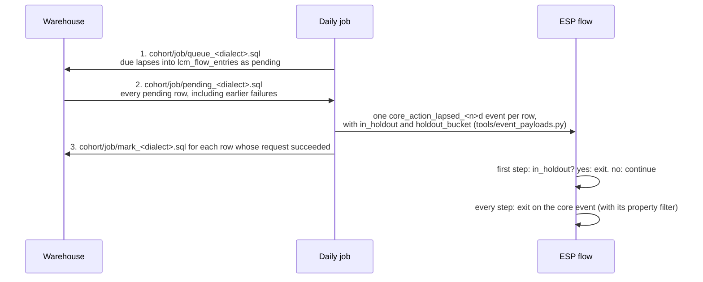

# The teammate: architecture for engineering partners

> **In plain English.** The teammate is a layer on top of the engine: a pipeline of agents that turns
> one campaign brief into a checked, build-ready plan, plus the plumbing a lifecycle program needs
> around it (event ingest, a daily health job, a Sheets log, an MCP server, one plain-English
> command). Claude writes language. Everything that must not be guessed (who enters, dates, splits,
> consent, law, sizing, syntax, payload shapes) is deterministic Python, tested in CI against
> fixtures and, for PostgreSQL, a real database. Version 2.2 made the pipeline stateful and
> resumable and added the Strategist, Compliance and engagement layers; `docs/AUDIT.md` lists why.

This page covers the teammate. The engine's own layers (context, protocol, modules, tools,
contracts) are in [`ARCHITECTURE.md`](ARCHITECTURE.md).

## 1. The pipeline

```mermaid
flowchart LR
    B["intake<br/>brief (YAML or one sentence)<br/>+ gate policy"] --> A["Analyst<br/>entry rule, SQL, dependencies,<br/>volume, baseline, countries, leak"]
    A --> S["Strategist<br/>touch jobs, channels, days,<br/>offer stance, with reasons"]
    S --> C["Architect<br/>compiles the strategy<br/>into a flow spec"]
    C --> W["Copywriter<br/>Claude or offline drafts,<br/>rendered per dialect, linted"]
    W --> E["Experiment<br/>persistent holdout,<br/>sizing, read date"]
    E --> Q["QA<br/>schema, simulation, payloads,<br/>SQL, copy, guardrails"]
    Q --> L["Compliance<br/>rules for the audience's<br/>jurisdictions"]
    L --> P["ExecutionPlan<br/>plan.md, flow_spec.json,<br/>cohort/*.sql, copy/*"]
```

Every arrow is a Pydantic model in `agents/models.py` (`Brief`, `CohortDefinition`, `Strategy`,
`FlowPlan`, `TouchCopy`, `ExperimentDesign`, `QAReport`, `ComplianceReport`, `ExecutionPlan`). A
malformed hand-off fails at the boundary. Provenance travels with the data: each unstated brief field
is an `Assumption`, each estimate carries a label (SUPPLIED, LIVE PULL, ESTIMATE, DEMO DATA, UNKNOWN),
and each decision a stage makes is a `Decision` with its reason, rendered as "Why the plan looks like
this" at the top of the plan.

| Agent | Decides | Never decides |
|---|---|---|
| Analyst (`agents/cohort_analyst.py`) | entry and exit rules, the absence trigger pattern per platform, SQL in four dialects, which dependencies are verified or blocked, the audience's countries, the onboarding step with the largest drop | anything without data behind it: unknown volume stays unknown |
| Strategist (`agents/strategist.py`) | the job of each touch, its day and channel, which requested channels the data cannot support, the offer stance, where the activation unblock touch aims | wording; anything the brief fixed |
| Architect (`agents/campaign_architect.py`) | nothing strategic: it compiles the strategy into a flow spec, consent conditions and fallbacks, the sunset, and build steps in the platform's vocabulary | copy |
| Copywriter (`agents/copywriter.py`) | nothing structural: it asks a writer (Claude, a human via handoff, or the offline library) for words, then renders and checks them | template syntax, compliance blocks: those are added by code |
| Experiment (`agents/experimentation_agent.py`) | the holdout design and its read label, using `tools/stats.py` | a lift on a population too small to support one |
| QA (`agents/stages.py`) | READY, READY WITH ASSUMPTIONS or BLOCKED from the checks below | |
| Compliance (`agents/compliance.py`) | pass, warn or fail per rule in `config/compliance_rules.json`, for the jurisdictions in the audience; a fail blocks the plan | legal sign-off: warn means ask counsel |

## 1a. State: runs, resume, revise, approve

`agents/pipeline.py` runs the stages in order and writes each one's output to
`out/<flow>/runs/<run_id>/stages/<stage>.json`, with `state.json` recording every stage's status,
attempts, timing, error and an input hash (the stage name, the engine version, the hashes of every
stage before it, and the inputs that stage reads: the brief, the data location and a fingerprint of
its files, the copy mode). `runs/latest` points at the newest run.

- **Failure.** An exception is recorded with its type, message and source line; the stages after it
  are marked skipped and the CLI exits 4. Timeouts and connection errors are retried (analyst twice,
  copywriter once, with backoff); a missing file or a validation error is not, since retrying cannot
  fix it.
- **Resume.** `orchestrator resume --run out/<flow> [--data ...]` loads the run and executes again: a
  stage whose input hash is unchanged is reused, so it restarts at the failed stage.
- **Revise.** `orchestrator revise --run out/<flow> --set touches=4` starts a new run with the brief
  changed and the old run as its parent. Copy is keyed on what shaped it (role, channel, job, goal,
  product, offer policy, voice, sender, variant count, dialect, mode); a touch whose key is unchanged
  keeps its words, re-rendered and re-linted, and its approval.
- **Approve.** `orchestrator approve --run out/<flow> --step t1_email --variant B` records the variant
  to ship; the plan marks it.

## 2. The absence trigger

Most ESPs cannot trigger on something not happening. The teammate makes absence an event:

A lapse is identified by the person and its **anchor date** (their last core action, or their
qualification if none since). The ledger table `lcm_flow_entries` is an outbox: the queue step
evaluates who is due and writes them as pending in one statement (anchors `n` to `n + 3` calendar
days before the run date, not already in the ledger), the job pushes every pending row, and the mark
step marks each row pushed, by its key, once the request carrying it succeeded. So each lapse enters
at most once; a missed run catches up for three days; a failed push stays pending and goes out on the
next run; rows read by an overlapping run are never marked by mistake; and a core event loaded late
simply moves that person's anchor, so they are queued on a later run rather than recorded without a
push. The one gap: a request that succeeded but whose mark failed is sent again. Platforms that
deduplicate on the event id, which is the lapse key (Klaviyo `unique_id`, HubSpot `uuid`,
Customer.io `messageId`), drop that repeat; Braze and Salesforce Marketing Cloud do not, so the job
should mark immediately after each request there. Holdout
members are pushed and exit at the first step, so both arms are the same population when they
diverge. `cohort/entry_<dialect>.sql` shows who is due without queuing anything.

**Activation flows** trigger on the live qualifying event instead (for example
`onboarding_step_completed` with `step_index = 3`, filtered at the trigger). The system that sends
that event adds `holdout_bucket` and `in_holdout` to it with the same formula; the build steps spell
it out. The webhook parser can be that system: with `LCM_FORWARD=1` it forwards each qualifying event
for an activation brief in `briefs/active/` to the brief's platform with both fields added, after it
has answered the CDP, and writes failed requests (with placeholders, never secrets) to
`forward_failed/` for replay. Their volume and baseline come from new qualifiers per month and the
share who reach the core action unaided, not from lapses.

**Calendar blast or trigger.** `cohort_analyst blast-vs-trigger` takes past blast dates (the first of
each of the last three months by default) and sorts everyone a blast reached into four bands against
the trigger's threshold: active (did the core action within half the threshold), at risk, on time
(lapsed up to a week past the threshold, when the trigger would have caught them) and late, with each
band's core-action rate in the following window. It is the comparison a marketer needs to retire a
newsletter slot for a trigger, computed on their own data.

**One assignment everywhere.** The bucket is the first 7 hex digits of
`md5(user_id || ':' || salt)` as an integer, modulo 100. It is written once per dialect in
`agents/sql_dialects.py` (PostgreSQL bit cast, Snowflake `TO_NUMBER(..., 'XXXXXXX')`, BigQuery
`CAST('0x...' AS INT64)`, DuckDB) and once in Python. Tests assert that Python, DuckDB, BigQuery
(transpiled) and PostgreSQL (executed) agree for every fixture user.

## 3. What QA checks

| Check | How |
|---|---|
| Sending gate | RED blocks; AMBER or no gate adds an engaged-only entry filter |
| Data dependencies | with `--data`: every event exists, property filters match rows, fill rates; a missing qualifying or core event blocks |
| Cohort SQL | entry and history queries parse in PostgreSQL, Snowflake and BigQuery (sqlglot); the DuckDB version runs on the data |
| Flow structure | `scripts/campaign_simulator.py`: schema, unique ids, branch targets, reachability, holdout before the first message, weekly cap on every route |
| Journeys | synthetic people walk the flow hour by hour: holdout gets nothing, no send without consent, nothing after the core action, cap, send hour, the brief's quiet hours, touch count, sunset only for non-clickers |
| Trigger payload | the example request validates against `config/esp_payload_schemas.json` |
| Copy | every variant: dialect lint (`tools/template_lint.py`), unsubscribe and address present, SMS segments and opt-out (`tools/sms.py`), offer policy, fake urgency, deceptive subjects, unknown tokens, text-to-image |
| Holdout read | causal, causal and slow, directional only, or not readable (`tools/stats.py feasible`) |
| Compliance | the rules for every jurisdiction in the audience: postal address, unsubscribe, sender identity, SMS hours (the strictest state window), SMS frequency, SMS and email consent, honest subjects, suppression, and the confirmations only a person can give |

## 4. The plumbing

| Piece | Role | Security |
|---|---|---|
| `scripts/webhook_parser.py` | Segment (Actions or classic) and GA4 Measurement Protocol bodies into canonical `track_events` rows, validated against the tracking plan, deduplicated on `event_id` and identify `messageId` (across restarts, from the last 3 days of files), rejects quarantined with reasons | HMAC-SHA1 `X-Signature` over the whole body for Segment (batched requests, which Segment signs on the first event only, are refused: turn batching off), shared token for GA4, constant-time compares; track and identify messages over 72 hours old refused over HTTP as possible replays; refuses unsigned traffic unless explicitly allowed; 5 MB body cap |
| `tools/event_payloads.py` | entry rows into Klaviyo, HubSpot (date-versioned 2026-09), Braze and Customer.io Pipelines requests within each vendor's limits | headers carry `${PLACEHOLDER}` names; no credential is ever written |
| `tools/payloads.py attribute_sync` | the engagement tier and sunset flag as person-attribute updates: Klaviyo bulk import, HubSpot batch upsert, Braze `/users/track` (75 per request, `_update_existing_only`), Customer.io Pipelines batch | same; nothing is sent from the tool |
| `agents/engagement.py` | engagement tiers from `message_events` (suppressed, engaged 30, 90 and 180 days, unengaged, new); clicks only; the unengaged share for the sending gate | reversible attribute, never an unsubscribe |
| `tools/dns_collect.py` | the live DNS pull for the deliverability analyzer (below) | read-only lookups; refuses to report on a domain that does not resolve |
| `scripts/daily.py` | the 05:00 UTC job: every brief in `briefs/active/`, the tiers, every domain in `LCM_DOMAINS`, one Sheets sync, `issues.json` for the workflow; one failing step does not stop the others | never writes to an ESP |
| `scripts/sheets_sync.py` | six tabs (Campaign Plans, Cohort Health, Benchmarks, Anomalies, Engagement, Deliverability) upserted on a key, so re-runs update rather than duplicate; exponential backoff on 429 and 5xx | service account only; dry-run CSVs when not configured |
| `.github/workflows/daily_cohort_audit.yml` | runs `scripts/daily.py` on BigQuery (keyless, Workload Identity Federation), a file URL, or demo fixtures; summary, Sheets, one issue per finding (opened, or commented on while open), artifact; fails at the end if a step failed | least-privilege `permissions`; secrets only in `secrets.*` |
| `agents/cli.py` (`lcm`) | a sentence or a YAML job to one of seven jobs (plan, deliverability, engagement, blast, audit, readout, size) by rules, asking for what is missing | runs the same code as the module CLIs |
| `scripts/mcp_server.py` | the teammate as eight MCP tools for Claude Desktop (mcp 2.x `MCPServer`): draft, plan, revise, approve, audit, engagement tiers, domain check, simulate | local stdio; writes only under `LCM_OUT_DIR`; sends nothing to any platform |

**Anomaly detection.** For each daily metric, the modified z-score (Iglewicz and Hoaglin) of the
latest complete day against the trailing 28 days: `0.6745 (x - median) / MAD`, flagged at |z| of
3.5 or more. Robust to the outliers that make a mean and standard deviation useless on lifecycle
data, and silent on series too small to judge (median under 5). Data older than two days is its
own finding: a stalled pipeline looks like a churn spike otherwise.

**DKIM selectors probed by default** (`tools/dns_collect.py SELECTOR_SOURCES`), read from each
provider's setup documentation on 2026-10-20: Google Workspace `google`; Microsoft 365 `selector1`,
`selector2`; Klaviyo static CNAMEs `km1`, `km2`, `kt1`, `kt2`, `ks1`, `ks2` and legacy `kl1`, `kl2`;
HubSpot `hs1`, `hs2` (current portals use `hs1-<hub id>`: pass `--hubspot-hub-id`); SendGrid, and
Braze on SendGrid, `s1`, `s2`; Mailchimp `k2`, `k3`; Mandrill `mte1`, `mte2`; Mailgun `pdk1`, `pdk2`;
OpenDKIM's `default`. Not probeable, so give them with `--selectors`: Amazon SES (random tokens),
Postmark (`<digits>pm`), Braze on SparkPost (`scph<digits>`), Customer.io (`cio` under a
`cio<digits>` subdomain), and Klaviyo dynamic mode and Salesforce Marketing Cloud (delegated
subdomains).

## 5. What is verified, and how

| Claim | Verified by | Not verified |
|---|---|---|
| The entry query selects the right people | `tests/test_agents.py` recomputes entrants from the CSVs in plain Python on 40 dates and compares; a simulated season of daily jobs with skipped runs and failed pushes shows every lapse pushed exactly once, and a late-loaded event is queued later rather than lost | behavior on warehouse data shapes the fixtures do not cover |
| Snowflake and BigQuery versions match | transpiled to DuckDB and compared on entry, history and audit queries; the Snowflake VARIANT path and hex parse, which sqlglot does not translate faithfully, are substituted in the test and the hex parse is checked against Snowflake's documented `TO_DECIMAL('ae5', 'XXX')` form | execution on a live Snowflake or BigQuery account |
| The PostgreSQL version is correct | executed on PostgreSQL 16 in CI (`tests/test_postgres.py`, a service container) and compared with DuckDB and Python, including the queue, pending and mark round trip | other PostgreSQL versions |
| Payloads match vendor APIs | JSON Schemas written from vendor documentation read on 2026-10-20 | a live request to each vendor |
| The Claude copy path works | a stub client exercises structured output parsing, the repair round, drop and block rules, and API failure fallback | a live API call in CI (no key in CI); the call uses the SDK's documented `messages.parse(output_format=...)` |
| Sheets sync is idempotent | an in-memory worksheet; retry on a synthetic 429 | a live Google Sheet |
| The MCP server works | tools listed and called in-process | a Claude Desktop session |
| Runs survive failure and change | `tests/test_pipeline_and_agents.py`: a failed analyst stage, then resume; a transient error retried once; a revision that reuses all copy and keeps an approval; refusal of unknown fields, steps and variants | concurrent writers to one run folder |
| Compliance applies the right rules | every rule names a check that exists and a source; jurisdictions from countries; the SMS window at four send hours | the law itself, which changes |
| The daily job holds up | demo mode end to end with one domain failing; BigQuery mode with its SQL transpiled to DuckDB; a dataset without message events | a live BigQuery or live DNS run in CI |

## 6. From the original specification to this repository

The teammate was specified as a standalone repository (`lcm-teammate`). It lives inside the engine
instead, so it reuses the engine's method and tools rather than restating them.

| Specified | Here |
|---|---|
| `agents/orchestrator.py`, `cohort_analyst.py`, `campaign_architect.py`, `experimentation_agent.py` | same paths; plus `agents/copywriter.py` (the copywriter agent the pipeline names), `models.py`, `brief.py`, `guardrails.py`, `sql_dialects.py` |
| `skills/behavioral_triggers.md` | `modules/02_behavioral_triggers_and_flows/` (the absence patterns per platform) and `agents/campaign_architect.py` |
| `skills/direct_response_copy.md` | `modules/03_copywriting_and_multichannel/prompts/dynamic_liquid_email_writer.md` and the copywriter's system prompt |
| `skills/retention_matrices.md` | `modules/04_data_schemas_and_sql/prompts/rfm_segmentation_builder.md`, the win-back module, and the audit's risk bands |
| `skills/dma_compliance_and_deliverability.md` | `modules/01_deliverability_and_infrastructure/` and `agents/guardrails.py` |
| `config/mcp_server_config.json`, `config/esp_payload_schemas.json` | same paths |
| `scripts/sheets_sync.py`, `scripts/webhook_parser.py` | same paths |
| `scripts/test_campaign_simulator.py` | `scripts/campaign_simulator.py` (a `test_` prefix would make pytest collect it as a test module); its tests are in `tests/test_teammate_pipeline.py` |
| `brief_template.yaml` | `briefs/brief_template.yaml`, with a worked example in `briefs/examples/` |
| `docs/quickstart_for_marketers.md`, `docs/architectural_overview.md` | same paths |
| `.github/workflows/daily_cohort_audit.yml` | same path |

## 7. Extending it

- **A platform:** add its dialect to `PLATFORM_DIALECT`, its vocabulary to `campaign_architect.VOCAB`,
  its absence pattern to `cohort_analyst.PLATFORM_PATTERNS`, its request to `tools/event_payloads.py`
  with a `$defs` entry in `config/esp_payload_schemas.json`, and its unsubscribe, address and
  first-name tokens to `agents/copywriter.py`. The parametrized platform test picks it up.
- **A touch role:** add it to `campaign_architect.ROLES` and the ordering tables, and a starter pair to
  the copywriter's offline library.
- **A warehouse:** add a `Dialect` branch for date arithmetic, JSON access and the bucket, then add it
  to the dialect-equivalence test.
- **A webhook source:** add a `from_<source>` normalizer that returns canonical rows and route it in
  `create_app`; reuse `_common` so it gets the tracking-plan validation and quarantine.
- **A compliance rule:** append it to `config/compliance_rules.json` with a `check` from
  `agents/compliance.CHECKS` (or add a check function), a jurisdiction, and a `source`; the
  rules-have-sources test keeps it honest.
- **A pipeline stage:** add it to `STAGES` and `OUTPUT_TYPES` in `agents/pipeline.py` and its function
  to `agents/stages.FUNCS`; persistence, retries, resume and the status view pick it up.
- **An lcm job:** add a pattern to `agents/cli.INTENTS`, its arguments in `route`, and its call in
  `run`.
