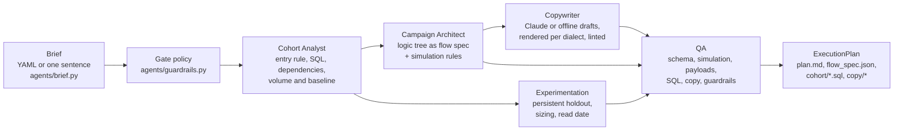
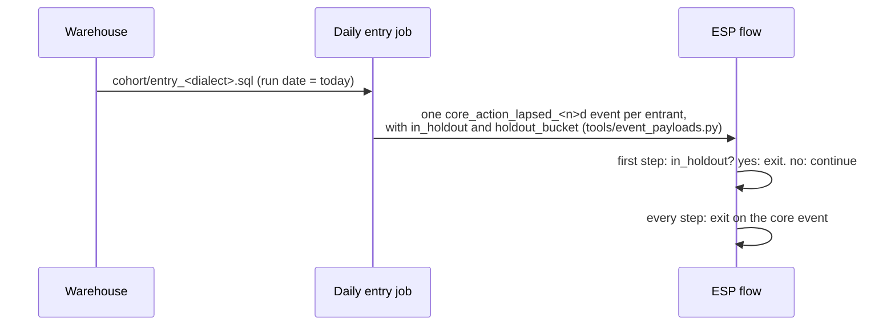

# The teammate: architecture for engineering partners

> **In plain English.** Version 2.1 adds a layer on top of the engine: four agents that turn one
> campaign brief into a checked, build-ready plan, plus the plumbing a lifecycle program needs
> around it (event ingest, a daily cohort audit, a Sheets log, an MCP server). Claude writes
> language. Everything that must not be guessed (who enters, dates, splits, consent, sizing, syntax,
> payload shapes) is deterministic Python, tested in CI against fixtures and, for PostgreSQL, a
> real database.

This page covers the teammate. The engine's own layers (context, protocol, modules, tools,
contracts) are in [`ARCHITECTURE.md`](ARCHITECTURE.md).

## 1. The pipeline

Every arrow is a Pydantic model in `agents/models.py` (`Brief`, `CohortDefinition`, `FlowPlan`,
`TouchCopy`, `ExperimentDesign`, `QAReport`, `ExecutionPlan`). A malformed hand-off fails at the
boundary. Provenance travels with the data: each unstated brief field is an `Assumption`, and each
estimate carries a label (SUPPLIED, LIVE PULL, ESTIMATE, DEMO DATA, UNKNOWN).

| Agent | Decides | Never decides |
|---|---|---|
| Cohort Analyst (`agents/cohort_analyst.py`) | entry and exit rules, the absence trigger pattern per platform, SQL in four dialects, which dependencies are verified or blocked | anything without data behind it: unknown volume stays unknown |
| Campaign Architect (`agents/campaign_architect.py`) | touch roles, days, channels, consent conditions and fallbacks, the sunset, build steps in the platform's vocabulary | copy |
| Copywriter (`agents/copywriter.py`) | nothing structural: it asks a writer (Claude, a human via handoff, or the offline library) for words, then renders and checks them | template syntax, compliance blocks: those are added by code |
| Experimentation (`agents/experimentation_agent.py`) | the holdout design and its read label, using `tools/stats.py` | a lift on a population too small to support one |
| QA (`agents/orchestrator.py`) | READY, READY WITH ASSUMPTIONS or BLOCKED from the checks below | |

## 2. The absence trigger

Most ESPs cannot trigger on something not happening. The teammate makes absence an event:

The entry query selects people whose last core action (or qualification, if none since) was
exactly `n` days before the run date, so each lapse enters once and a returning customer can lapse
again later. Holdout members are pushed too and exit at the first step, so both arms are the same
population when they diverge.

**One assignment everywhere.** The bucket is the first 7 hex digits of
`md5(user_id || ':' || salt)` as an integer, modulo 100. It is written once per dialect in
`agents/sql_dialects.py` (PostgreSQL bit cast, Snowflake `TO_NUMBER(..., 'XXXXXXX')`, BigQuery
`CAST('0x...' AS INT64)`, DuckDB) and once in Python. Tests assert that Python, DuckDB, BigQuery
(transpiled) and PostgreSQL (executed) agree for every fixture user.

## 3. What QA checks

| Check | How |
|---|---|
| Sending gate | RED blocks; AMBER or no gate adds an engaged-only entry filter |
| Data dependencies | with `--data`: every event exists, property filters match rows, fill rates; a missing qualifying or core event blocks |
| Cohort SQL | entry and history queries parse in PostgreSQL, Snowflake and BigQuery (sqlglot); the DuckDB version runs on the data |
| Flow structure | `scripts/campaign_simulator.py`: schema, unique ids, branch targets, reachability, holdout before the first message, weekly cap on every route |
| Journeys | synthetic people walk the flow hour by hour: holdout gets nothing, no send without consent, nothing after the core action, cap, send hour, quiet hours, touch count, sunset only for non-clickers |
| Trigger payload | the example request validates against `config/esp_payload_schemas.json` |
| Copy | every variant: dialect lint (`tools/template_lint.py`), unsubscribe and address present, SMS segments and opt-out (`tools/sms.py`), offer policy, fake urgency, deceptive subjects, unknown tokens, text-to-image |
| Holdout read | causal, causal and slow, directional only, or not readable (`tools/stats.py feasible`) |

## 4. The plumbing

| Piece | Role | Security |
|---|---|---|
| `scripts/webhook_parser.py` | Segment (Actions or classic) and GA4 Measurement Protocol bodies into canonical `track_events` rows, validated against the tracking plan, deduplicated on `event_id`, rejects quarantined with reasons | HMAC-SHA1 `X-Signature` for Segment, shared token for GA4, constant-time compares; refuses unsigned traffic unless explicitly allowed; 5 MB body cap |
| `tools/event_payloads.py` | entry rows into Klaviyo, HubSpot (date-versioned 2026-09), Braze and Customer.io Pipelines requests within each vendor's limits | headers carry `${PLACEHOLDER}` names; no credential is ever written |
| `scripts/sheets_sync.py` | four tabs upserted on a key, so re-runs update rather than duplicate; exponential backoff on 429 and 5xx | service account only; dry-run CSVs when not configured |
| `.github/workflows/daily_cohort_audit.yml` | 05:00 UTC audit: BigQuery (keyless, Workload Identity Federation), a file URL, or demo fixtures; summary, Sheets, issue on anomaly, artifact | least-privilege `permissions`; secrets only in `secrets.*` |
| `scripts/mcp_server.py` | the teammate as four MCP tools for Claude Desktop (mcp 2.x `MCPServer`) | local stdio; writes only under `LCM_OUT_DIR` |

**Anomaly detection.** For each daily metric, the modified z-score (Iglewicz and Hoaglin) of the
latest complete day against the trailing 28 days: `0.6745 (x - median) / MAD`, flagged at |z| of
3.5 or more. Robust to the outliers that make a mean and standard deviation useless on lifecycle
data, and silent on series too small to judge (median under 5). Data older than two days is its
own finding: a stalled pipeline looks like a churn spike otherwise.

## 5. What is verified, and how

| Claim | Verified by | Not verified |
|---|---|---|
| The entry query selects the right people | `tests/test_agents.py` recomputes entrants from the CSVs in plain Python on 40 dates and compares | behavior on warehouse data shapes the fixtures do not cover |
| Snowflake and BigQuery versions match | transpiled to DuckDB and compared on entry, history and audit queries; the Snowflake VARIANT path and hex parse, which sqlglot does not translate faithfully, are substituted in the test and the hex parse is checked against Snowflake's documented `TO_DECIMAL('ae5', 'XXX')` form | execution on a live Snowflake or BigQuery account |
| The PostgreSQL version is correct | executed on PostgreSQL 16 in CI (`tests/test_postgres.py`, a service container) and compared with DuckDB and Python | other PostgreSQL versions |
| Payloads match vendor APIs | JSON Schemas written from vendor documentation read on 2026-10-20 | a live request to each vendor |
| The Claude copy path works | a stub client exercises structured output parsing, the repair round, drop and block rules, and API failure fallback | a live API call in CI (no key in CI); the call uses the SDK's documented `messages.parse(output_format=...)` |
| Sheets sync is idempotent | an in-memory worksheet; retry on a synthetic 429 | a live Google Sheet |
| The MCP server works | tools listed and called in-process | a Claude Desktop session |

## 6. From the original specification to this repository

The teammate was specified as a standalone repository (`lcm-teammate`). It lives inside the engine
instead, so it reuses the engine's method and tools rather than restating them.

| Specified | Here |
|---|---|
| `agents/orchestrator.py`, `cohort_analyst.py`, `campaign_architect.py`, `experimentation_agent.py` | same paths; plus `agents/copywriter.py` (the copywriter agent the pipeline names), `models.py`, `brief.py`, `guardrails.py`, `sql_dialects.py` |
| `skills/behavioral_triggers.md` | `modules/02_behavioral_triggers_and_flows/` (the absence patterns per platform) and `agents/campaign_architect.py` |
| `skills/direct_response_copy.md` | `modules/03_copywriting_and_multichannel/prompts/dynamic_liquid_email_writer.md` and the copywriter's system prompt |
| `skills/retention_matrices.md` | `modules/04_data_schemas_and_sql/prompts/rfm_segmentation_builder.md`, the win-back module, and the audit's risk bands |
| `skills/dma_compliance_and_deliverability.md` | `modules/01_deliverability_and_infrastructure/` and `agents/guardrails.py` |
| `config/mcp_server_config.json`, `config/esp_payload_schemas.json` | same paths |
| `scripts/sheets_sync.py`, `scripts/webhook_parser.py` | same paths |
| `scripts/test_campaign_simulator.py` | `scripts/campaign_simulator.py` (a `test_` prefix would make pytest collect it as a test module); its tests are in `tests/test_teammate_pipeline.py` |
| `brief_template.yaml` | `briefs/brief_template.yaml`, with a worked example in `briefs/examples/` |
| `docs/quickstart_for_marketers.md`, `docs/architectural_overview.md` | same paths |
| `.github/workflows/daily_cohort_audit.yml` | same path |

## 7. Extending it

- **A platform:** add its dialect to `PLATFORM_DIALECT`, its vocabulary to `campaign_architect.VOCAB`,
  its absence pattern to `cohort_analyst.PLATFORM_PATTERNS`, its request to `tools/event_payloads.py`
  with a `$defs` entry in `config/esp_payload_schemas.json`, and its unsubscribe, address and
  first-name tokens to `agents/copywriter.py`. The parametrized platform test picks it up.
- **A touch role:** add it to `campaign_architect.ROLES` and the ordering tables, and a starter pair to
  the copywriter's offline library.
- **A warehouse:** add a `Dialect` branch for date arithmetic, JSON access and the bucket, then add it
  to the dialect-equivalence test.
- **A webhook source:** add a `from_<source>` normalizer that returns canonical rows and route it in
  `create_app`; reuse `_common` so it gets the tracking-plan validation and quarantine.
