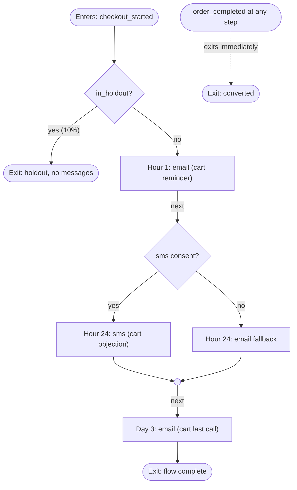

# Abandoned cart: Northfield Coffee Roasters

**Status: READY WITH ASSUMPTIONS** | Klaviyo | generated 2026-10-23T00:51:41+00:00 | run cae8d56179e8 | LMM Engine 3.0.0

## In one paragraph

People who started checkout and did not place an order within 1 hour(s). They enter then, at most once every P7D, and leave the moment they place an order. The flow sends up to 3 message(s) over 3 days (email, sms), starts with a 10% holdout that receives nothing, and stops the moment they place an order. About 351 people a month (DEMO DATA) would enter; 31.3% get there within 10 days on their own (DEMO DATA). Read: directional only. AMBER gate: people active in the last day, no volume growth (no sending gate on record, so the plan runs as AMBER. Run the deliverability check (lcm "check deliverability for <your domain>") to lift this).

## Confirm before you build

- **sending_gate**: no sending gate on record; treated as AMBER (engaged recipients only) until the deliverability-gate skill or engine/deliverability/analyze.py issues one
- **monthly_entrants**: estimated from the data (DEMO DATA): 351 a month, mean abandoned checkouts over 3 complete month(s) to 2026-09
- **baseline_conversion_rate**: estimated from the data (DEMO DATA): 31.3%, 551 of 1759 matured abandoned checkouts ordered anyway within 10 days with no flow
- **outcome_window_days**: not stated; set to 10 days so the whole flow (last touch on day 3) plus a week is inside it
- **sending gate**: AMBER gate: people active in the last day, no volume growth (no sending gate on record, so the plan runs as AMBER. Run the deliverability check (lcm "check deliverability for <your domain>") to lift this)
- **holdout read**: directional only: not inside 12 months at this volume (it would take about 15 months): keep the holdout, report against a pre/post baseline, and label every result directional
- **compliance: one-click unsubscribe and complaint rate**: mailbox providers: Gmail and Yahoo require bulk senders' marketing mail to carry one-click unsubscribe (RFC 8058) plus a visible unsubscribe link, honored within two days, and to keep user-reported spam under 0.3% (Gmail's target is under 0.1%). One-click unsubscribe is a header your platform adds: confirm it is on (engine/deliverability/analyze.py checks it in real headers).
- **compliance: bulk-sender authentication**: mailbox providers: Gmail, Yahoo and Microsoft (Outlook.com, Hotmail.com and Live.com since 5 May 2025) require senders of more than 5,000 messages a day to pass SPF and DKIM and publish DMARC (p=none or stricter) aligned with one of them; Microsoft sends failing mail to junk, then rejects it with 550 5.7.515. Run lcm "check deliverability for <your sending domain>" (engine/deliverability/dns_collect.py) and resolve anything RED before launch.
- **compliance: CAN-SPAM ad identification**: United States: A commercial message must be identified as an advertisement unless the recipient gave prior affirmative consent to receive it. Confirm every recipient opted in to marketing email, or add a clear advertisement disclosure.
- **compliance: state texting hours (strictest tracked)**: United States: States set narrower windows than the TCPA: Connecticut 9 a.m. to 8 p.m. (texts covered); Oregon 8 a.m. to 8 p.m. (texts covered from 1 January 2026); Florida, Oklahoma and Maryland 8 a.m. to 8 p.m.; Texas 9 a.m. to 9 p.m., noon on Sundays. Recipient state is not known per person, so the send hour must fall inside 9 a.m. to 8 p.m. local, and a send before noon is flagged for Sundays. These are the state rules this file tracks, not every state's. SMS send at 10:00 is inside 09:00 to 20:00, but on Sundays the window opens at 12:00; set send_hour_local to 12 or later, or have the ESP skip Sundays.
- **compliance: Sunday texting**: United States: Texas limits telephone solicitation to noon to 9 p.m. on Sundays, and several other states restrict Sunday solicitation further or ban it; whether those rules reach texts is not settled. Decide with counsel whether marketing texts skip Sundays (most ESPs can exclude a weekday from a flow's send window).
- **compliance: state texting consent and opt-out records**: United States: Florida's Telephone Solicitation Act covers texts and requires a STOP reply to be honored; Washington bars commercial texts to Washington numbers without consent; Virginia requires a STOP or UNSUBSCRIBE reply to be honored for at least 10 years. Confirm SMS opt-outs are kept for at least 10 years and never re-opted in by a later import.
- **compliance: CASL consent**: Canada: Commercial electronic messages need express or implied consent. Every email requires a consent record; 76% of records carry a consent timestamp. Implied consent expires: two years after a purchase, six months after an inquiry or application. Exclude Canadian records whose implied consent has lapsed, or confirm they gave express consent.
- **compliance: PECR consent or soft opt-in**: United Kingdom: Marketing email to individuals needs specific consent, or the soft opt-in for people who bought or negotiated to buy a similar product and were offered an opt-out at collection and in every message. The ICO is revising this guidance after the Data (Use and Access) Act. Every email requires a consent record; 76% of records carry a consent timestamp. Confirm each UK record has consent or qualifies for the soft opt-in.
- **compliance**: 17 rule(s) checked for Canada, United Kingdom, United States

## Why the plan looks like this

| Agent | Decision | Why |
|---|---|---|
| intake | sending gate AMBER | AMBER gate: people active in the last day, no volume growth (no sending gate on record, so the plan runs as AMBER. Run the deliverability check (lcm "check deliverability for <your domain>") to lift this) |
| analyst | entry rule | People who started checkout and did not place an order within 1 hour(s). They enter then, at most once every P7D, and leave the moment they place an order. |
| strategist | touches at 1h, 24h, 72h after checkout_started | intent fades in hours, not days; each send is held to its channel's permitted window |
| strategist | offer stance | offers only as the policy allows (10% off on the second order, not stackable, expires P3D after send); only in cart last call; never in the first touch; excluded for discount share over 50pct last 3 orders, redeemed offer last 30d |
| experiment | 10% persistent holdout, read: directional only | not inside 12 months at this volume (it would take about 15 months): keep the holdout, report against a pre/post baseline, and label every result directional |
| compliance | compliance warn | jurisdictions in the audience: Canada, United Kingdom, United States |

## Who enters

| | |
|---|---|
| Entry | checkout_started by an identified person (an email address on the profile); no order_completed in the 1 hour(s) after it; re-entry: allowed again P7D after entering |
| Never enters | no consent for any channel in the flow; on the platform's suppression list; internal or test account |
| Exit | leaves the moment they place an order |
| Trigger | checkout_started: Metric-triggered flow on Started Checkout (Shopify's own event, or checkout_started sent by the engine). First step: a time delay of 1 hour(s). Flow filter: Placed Order zero times since starting this flow. Re-entry: once per 7 days (flow settings, or a filter 'has not been in this flow in the last 7 days'). |
| Monthly entrants | 351 (DEMO DATA: mean abandoned checkouts over 3 complete month(s) to 2026-09) |
| Reach the core action with no flow | 31.3% (DEMO DATA: 551 of 1759 matured abandoned checkouts ordered anyway within 10 days with no flow) |
| Entering on 2026-10-18 | 14 |

| Data dependency | Kind | Status | Fill | Note |
|---|---|---|---|---|
| checkout_started | event | verified |  | qualifies a person for the flow; 3528 events from 1281 people |
| order_completed | object | verified |  | the core action: entry clock, exit and primary metric; orders table (the transaction object): 1280 completed orders, 693 people |
| email | attribute | verified | 100% | address for every email touch; users.email filled 100% |
| email_consent | attribute | verified | 76% | email marketing consent; users.email_consent_at filled 76% |
| sms_consent | attribute | verified | 17% | SMS consent with an auditable record (10DLC); users.sms_consent_at filled 17% |
| in_holdout | attribute | unknown |  | a property on the checkout_started event, added where it is sent (formula in the build steps) |
| lcm_sunset | attribute | unknown |  | suppression flag the sunset step writes; create the property in the platform before launch |

The trigger is the live checkout_started event. `cohort/entry_bigquery.sql` backfills and audits it; the history query (`cohort/history_*.sql`) measured the volume and unaided rate above.

## The flow

| Day | Step | Channel | Job | Only if |
|---:|---|---|---|---|
| 0 | t1_email | email | Their cart, exactly as they left it (the product block), with one button back to checkout. No offer. |  |
| 1 | t2_sms | sms | Answer the most common reason people stop at checkout (shipping cost, delivery time, returns), with the cart below. | has SMS consent |
| 1 | t2_email_fallback | email | Answer the most common reason people stop at checkout (shipping cost, delivery time, returns), with the cart below. | fallback for people without sms consent |
| 3 | t3_email | email | A last, short reminder that the cart is saved; the offer only if the offer policy allows one, and a deadline only if the offer has one. |  |

Every step: has not done order_completed since entering; can receive email marketing (subscribed, not bounced, not sunset-suppressed). Frequency: at most 4 email/sms/push message(s) per week; at most 1 sms message(s) per day across flows (Smart Sending). Permitted send windows, recipient local: email 08:00 to 21:00; sms 09:00 to 20:00.

| Touch | Why this job and channel |
|---|---|
| 1. day 0, cart reminder, email | most recovered carts come from the first hour: show the cart, nothing else; email carries the long-form message, the unsubscribe and the fallback for every other channel |
| 2. day 1, cart objection, sms | the second touch answers why they stopped (cost, timing, returns) instead of repeating the first; SMS is used once, mid-flow, for a short prompt; it is the channel people tolerate least |
| 3. day 3, cart last call, email | a final reminder while intent is still warm; the offer, if any, comes last so early buyers pay full price; email carries the long-form message, the unsubscribe and the fallback for every other channel |

## Build it in Klaviyo

1. Confirm checkout_started reaches Klaviyo in real time; it is the trigger. Add two properties to it where it is sent: holdout_bucket = first 7 hex digits of md5(user_id + ':northfield_coffee_cart_abandon_1h') as an integer, mod 100, and in_holdout = holdout_bucket < 10. The same formula is in engine/sql/dialects.py (Python and SQL), so the readout can recompute the arms in the warehouse.
2. Native trigger: Metric-triggered flow on Started Checkout (Shopify's own event, or checkout_started sent by the engine). First step: a time delay of 1 hour(s). Flow filter: Placed Order zero times since starting this flow. Re-entry: once per 7 days (flow settings, or a filter 'has not been in this flow in the last 7 days').
3. Create a flow and set every message to Manual status until it is approved. Metric trigger: checkout_started.
4. Entry filters (checked once at entry): is identified (has an email address on the profile); anonymous checkout_started events cannot enter; has not done order_completed in the 1 hour(s) after checkout_started; not in the program-wide global holdout (bucket of md5(user_id || ':lmm_global') under 5); the trigger is the person's own activity in the last day (a checkout, a product view, an order), which counts as engagement; anyone with no click, reply, order or session in 365 days is still excluded.
5. Checked before every step (Flow filter): has not done order_completed since entering; can receive email marketing (subscribed, not bounced, not sunset-suppressed).
6. First step, Conditional split: in_holdout is true goes to exit; everyone else continues. Nothing sends before this split.
7. Re-entry: allowed again P7D after entering.
8. Time delay to 1 hours after checkout_started, held to the email send window (the time delay's 'delay until a specific time' window (or Smart Send Time)), then email message t1_email: cart reminder.
9. Time delay to 24 hours after checkout_started, held to the sms send window (the time delay's 'delay until a specific time' window (or Smart Send Time)), then sms message t2_sms only if has SMS consent: cart objection.
10. Time delay to 24 hours after checkout_started, held to the email send window (the time delay's 'delay until a specific time' window (or Smart Send Time)), then email message t2_email_fallback only if fallback for people without sms consent: cart objection.
11. Time delay to 72 hours after checkout_started, held to the email send window (the time delay's 'delay until a specific time' window (or Smart Send Time)), then email message t3_email: cart last call.
12. Frequency: at most 4 email/sms/push message(s) per week; at most 1 sms message(s) per day across flows (Smart Sending). Permitted send windows, recipient local: email 08:00 to 21:00; sms 09:00 to 20:00. Priority 1 of the program's flows (higher priority preempts).
13. Before enabling: run lcm simulate on flow_spec.json (engine/policy/simulator.py), send every message to a seed list, and get approval. Exit on order_completed must be live before the first send.

## The copy

### t1_email (email, supplied)

| Variant | Copy | Framework | Hypothesis |
|---|---|---|---|
| A | **Your coffee is still in your cart** / We kept it exactly as you left it | Plain reminder | Showing the saved cart with one button recovers more checkouts than a generic reminder; falsified if B recovers as many or more within 72 hours. |
| B | **{item_name} is waiting for you** / Pick up right where you stopped | Plain reminder | Naming the item in the subject line lifts opens and recovery; falsified if A recovers as many or more within 72 hours. |

Files: `copy/t1_email_A.html`, `copy/t1_email_A.mjml`, `copy/t1_email_A.subject.txt`, `copy/t1_email_A.txt`, `copy/t1_email_B.html`, `copy/t1_email_B.mjml`, `copy/t1_email_B.subject.txt`, `copy/t1_email_B.txt`

### t2_sms (sms, supplied)

| Variant | Copy | Framework | Hypothesis |
|---|---|---|---|
| A | Not sure which grind to pick? Reply with how you brew and we will tell you. | Objection handling | Answering the grind question by text removes the most common coffee-specific hesitation; falsified if B recovers as many or more. |
| B | Shipping shows at checkout before you pay, so there are no surprises. Your cart: | Objection handling | Naming when shipping cost appears answers the cost worry; falsified if A recovers as many or more. |

Files: `copy/t2_sms_A.json`, `copy/t2_sms_B.json`

### t2_email_fallback (email, supplied)

| Variant | Copy | Framework | Hypothesis |
|---|---|---|---|
| A | **Which grind should you choose?** / Tell us how you brew and we will tell you | Objection handling | A concrete grind answer converts people who stopped over the choice; falsified if B recovers as many or more within 72 hours. |
| B | **No surprises at checkout** / Shipping shows before you pay | Objection handling | Saying where shipping cost appears answers the most common cost worry; falsified if A recovers as many or more within 72 hours. |

Files: `copy/t2_email_fallback_A.html`, `copy/t2_email_fallback_A.mjml`, `copy/t2_email_fallback_A.subject.txt`, `copy/t2_email_fallback_A.txt`, `copy/t2_email_fallback_B.html`, `copy/t2_email_fallback_B.mjml`, `copy/t2_email_fallback_B.subject.txt`, `copy/t2_email_fallback_B.txt`

### t3_email (email, supplied)

| Variant | Copy | Framework | Hypothesis |
|---|---|---|---|
| A | **Last reminder about your cart** / It is saved, if you still want it | Plain last reminder | A short, honest last note recovers late buyers without an offer; falsified if B recovers as many or more within 7 days. |
| B | **Still want {item_name}?** / Your cart is saved for you | Plain last reminder | Naming the item one last time recovers more than a generic note; falsified if A recovers as many or more within 7 days. |

Files: `copy/t3_email_A.html`, `copy/t3_email_A.mjml`, `copy/t3_email_A.subject.txt`, `copy/t3_email_A.txt`, `copy/t3_email_B.html`, `copy/t3_email_B.mjml`, `copy/t3_email_B.subject.txt`, `copy/t3_email_B.txt`

## Measurement

| | |
|---|---|
| Holdout | 10%, user level, persistent: persistent, by user: bucket = first 7 hex digits of md5(user_id || ':northfield_coffee_cart_abandon_1h') mod 100; bucket < 10 is the holdout, added as in_holdout to the live checkout_started event by the system that sends it; holdout members enter, then exit at holdout_split, so both arms are the same population |
| Primary metric | placed an order (order_completed) within 10 days of entry, treatment vs holdout, both arms counted from their entry date |
| Sizing | about 351 entrants a month (DEMO DATA), 31.3% return within 10 days with no flow (DEMO DATA), 20% relative lift (6.3 pts) worth acting on: 508 holdout entrants at 10%, 14.5 months of entries plus the 10-day outcome window, so the read lands about 14.8 months after launch (engine/measurement/stats.py feasible --entries-per-month 350.7 --holdout 0.1 --baseline 0.3132 --mde-rel 0.2 --outcome-window-days 10) |
| Read | directional only: not inside 12 months at this volume (it would take about 15 months): keep the holdout, report against a pre/post baseline, and label every result directional |
| Decision rule | Keep the flow when the 95% interval for (treatment minus holdout) rate of order_completed lies above zero and the guardrails hold. If it spans zero at the planned read, report it as inconclusive: keep the holdout running or change the flow. Report attributed, incremental and the gap together (lcm readout). |
| Sample ratio | At every look, test the split against 90/10 (lcm readout --expected-holdout 0.1). A chi-square p below 0.001 means assignment or logging is broken; read nothing until it is fixed. |
| Peeking | One planned read on the date above. Earlier looks check sample ratio and guardrails only; no early stop for a good-looking lift. |
| Guardrails | spam complaint rate per send below 0.1% (Gmail's target; 0.3% is its hard limit); unsubscribe rate per send, against the 90-day median for your lifecycle sends; pause a touch running above twice it; hard bounce rate below 1%; SMS opt-out rate per send, against your SMS program's median |
| Copy tests | Copy variants rotate evenly inside the treatment arm. Read them on clicks or the core action, never opens, and only directionally below about 1,000 sends per variant (size exactly with engine/measurement/stats.py size --baseline <click rate> --mde-rel 0.2) |

| Months of entries | Holdout n | Treatment n | Smallest detectable lift |
|---:|---:|---:|---|
| 3 | 105 | 946 | 14.05 pts (45% relative) |
| 6 | 210 | 1,893 | 9.85 pts (31% relative) |
| 12 | 420 | 3,787 | 6.9 pts (22% relative) |

## Deliverability guardrails

- Gate: AMBER gate: people active in the last day, no volume growth (no sending gate on record, so the plan runs as AMBER. Run the deliverability check (lcm "check deliverability for <your domain>") to lift this). Audience: people active in the last day.
- Suppressed: unsubscribed from marketing email, or hard bounced
- Suppressed: marked any message as spam (complaint), ever
- Suppressed: sunset-suppressed (lcm_sunset is true); only a fresh opt-in lifts it
- Suppressed: internal, test and seed addresses
- Suppressed: currently in a higher-priority flow (by the frequency policy's flow_priority: billing, cart, post-purchase first)
- One re-permission ask per person per 180 days, across all flows.
- No click on the re-permission ask within 14 days: set lcm_sunset = true and stop marketing mail. Keep the record; never delete it.
- A sunset-suppressed person re-enters only through an explicit opt-in action, never through a flow.
- Hard bounces are never mailed again; complaints are suppressed permanently.
- Unsubscribes, including one-click (RFC 8058), are honored within 2 days on every platform the person is on.
- On an AMBER gate, win-back entrants are limited to people who clicked or replied in the last 90 days.
- Every email carries the platform's unsubscribe token and a postal address; every SMS carries opt-out language; every template is linted in its dialect; image-only email is blocked.

## Compliance

**WARN** for Canada, United Kingdom, United States. Rules engine, not legal advice: it checks the plan against the rules in config/compliance_rules.json, each with its source. Confirm anything marked warn with counsel.

| Rule | Jurisdiction | Result | Detail | Source |
|---|---|---|---|---|
| one-click unsubscribe and complaint rate | mailbox providers | WARN | Gmail and Yahoo require bulk senders' marketing mail to carry one-click unsubscribe (RFC 8058) plus a visible unsubscribe link, honored within two days, and to keep user-reported spam under 0.3% (Gmail's target is under 0.1%). One-click unsubscribe is a header your platform adds: confirm it is on (engine/deliverability/analyze.py checks it in real headers). | https://support.google.com/mail/answer/81126 |
| bulk-sender authentication | mailbox providers | WARN | Gmail, Yahoo and Microsoft (Outlook.com, Hotmail.com and Live.com since 5 May 2025) require senders of more than 5,000 messages a day to pass SPF and DKIM and publish DMARC (p=none or stricter) aligned with one of them; Microsoft sends failing mail to junk, then rejects it with 550 5.7.515. Run lcm "check deliverability for <your sending domain>" (engine/deliverability/dns_collect.py) and resolve anything RED before launch. | https://support.google.com/mail/answer/81126 |
| suppression of opt-outs, bounces and complaints | mailbox providers | PASS | Never mail people who unsubscribed, hard bounced or complained. Unsubscribes, hard bounces and spam complaints are suppressed in every step. | https://support.google.com/mail/answer/81126 |
| CAN-SPAM postal address | United States | PASS | Commercial email must include the sender's valid physical postal address (a registered PO box or private mailbox counts). A postal address or the platform's address token is in all 6 emails. | https://www.ftc.gov/business-guidance/resources/can-spam-act-compliance-guide-business |
| CAN-SPAM opt-out | United States | PASS | Commercial email must offer a clear way to opt out that keeps working for at least 30 days after the send, honored within 10 business days. Every email carries the platform's unsubscribe link. Honoring requests within 10 business days is a process requirement on your platform: confirm it. | https://www.ftc.gov/business-guidance/resources/can-spam-act-compliance-guide-business |
| CAN-SPAM honest subject and header | United States | PASS | Subject lines and header information must not mislead. No subject implies a prior conversation; the guardrails also block fake urgency and offers outside policy. | https://www.ftc.gov/business-guidance/resources/can-spam-act-compliance-guide-business |
| CAN-SPAM ad identification | United States | WARN | A commercial message must be identified as an advertisement unless the recipient gave prior affirmative consent to receive it. Confirm every recipient opted in to marketing email, or add a clear advertisement disclosure. | https://www.ftc.gov/business-guidance/resources/can-spam-act-compliance-guide-business |
| TCPA texting hours | United States | PASS | Marketing texts only between 8 a.m. and 9 p.m. at the recipient's location. SMS send at 10:00 recipient local is inside 08:00 to 21:00. | https://www.ecfr.gov/current/title-47/chapter-I/subchapter-B/part-64/subpart-L/section-64.1200 |
| TCPA consent and opt-out | United States | PASS | Marketing texts need the recipient's prior express written consent and an opt-out. Every SMS step requires recorded SMS consent and every SMS carries STOP opt-out language. | https://www.ecfr.gov/current/title-47/chapter-I/subchapter-B/part-64/subpart-L/section-64.1200 |
| state texting hours (strictest tracked) | United States | WARN | States set narrower windows than the TCPA: Connecticut 9 a.m. to 8 p.m. (texts covered); Oregon 8 a.m. to 8 p.m. (texts covered from 1 January 2026); Florida, Oklahoma and Maryland 8 a.m. to 8 p.m.; Texas 9 a.m. to 9 p.m., noon on Sundays. Recipient state is not known per person, so the send hour must fall inside 9 a.m. to 8 p.m. local, and a send before noon is flagged for Sundays. These are the state rules this file tracks, not every state's. SMS send at 10:00 is inside 09:00 to 20:00, but on Sundays the window opens at 12:00; set send_hour_local to 12 or later, or have the ESP skip Sundays. | https://prdext3.cga.ct.gov/2025/pub/chap_743m.htm |
| Sunday texting | United States | WARN | Texas limits telephone solicitation to noon to 9 p.m. on Sundays, and several other states restrict Sunday solicitation further or ban it; whether those rules reach texts is not settled. Decide with counsel whether marketing texts skip Sundays (most ESPs can exclude a weekday from a flow's send window). | https://sll.texas.gov/faqs/how-late-can-telemarketers-call |
| state texting frequency (strictest tracked) | United States | PASS | Oregon (texts covered), Florida, Oklahoma and Maryland limit marketing contacts on the same subject to three per 24 hours. At most 1 SMS in any 24 hours (limit 3). | https://www.oregonlegislature.gov/bills_laws/lawsstatutes/2025orlaw0580.pdf |
| state texting consent and opt-out records | United States | WARN | Florida's Telephone Solicitation Act covers texts and requires a STOP reply to be honored; Washington bars commercial texts to Washington numbers without consent; Virginia requires a STOP or UNSUBSCRIBE reply to be honored for at least 10 years. Confirm SMS opt-outs are kept for at least 10 years and never re-opted in by a later import. | https://www.flsenate.gov/laws/statutes/2024/501.059 |
| CASL consent | Canada | WARN | Commercial electronic messages need express or implied consent. Every email requires a consent record; 76% of records carry a consent timestamp. Implied consent expires: two years after a purchase, six months after an inquiry or application. Exclude Canadian records whose implied consent has lapsed, or confirm they gave express consent. | https://ised-isde.canada.ca/site/canada-anti-spam-legislation/en/node/7 |
| CASL identification and unsubscribe | Canada | PASS | Messages must identify the sender, give contact information and a no-cost unsubscribe mechanism, honored within 10 business days. Every email carries the platform's unsubscribe link. Honoring requests within 10 business days is a process requirement on your platform: confirm it. | https://ised-isde.canada.ca/site/canada-anti-spam-legislation/en/node/7 |
| CASL sender identification | Canada | PASS | Every message identifies who sent it and on whose behalf, with a mailing address and a phone number, email or web address that stays valid for 60 days. Every email footer names the sender and every SMS starts with the brand name. | https://ised-isde.canada.ca/site/canada-anti-spam-legislation/en/node/7 |
| PECR consent or soft opt-in | United Kingdom | WARN | Marketing email to individuals needs specific consent, or the soft opt-in for people who bought or negotiated to buy a similar product and were offered an opt-out at collection and in every message. The ICO is revising this guidance after the Data (Use and Access) Act. Every email requires a consent record; 76% of records carry a consent timestamp. Confirm each UK record has consent or qualifies for the soft opt-in. | https://ico.org.uk/for-organisations/direct-marketing-and-privacy-and-electronic-communications/guide-to-pecr/electronic-and-telephone-marketing/electronic-mail-marketing/ |

## QA

| Check | Result | Detail |
|---|---|---|
| sending gate | WARN | AMBER gate: people active in the last day, no volume growth (no sending gate on record, so the plan runs as AMBER. Run the deliverability check (lcm "check deliverability for <your domain>") to lift this) |
| data dependencies | PASS | every event and attribute the flow needs is present |
| cohort SQL | PASS | every generated query parses in postgres, snowflake and bigquery; entry query ran on the data |
| simulation: flow spec matches schemas/flow_spec.schema.json | PASS | valid |
| simulation: step ids are unique | PASS | unique |
| simulation: every branch target is a step or an exit | PASS | all resolve |
| simulation: every step is reachable | PASS | all reachable |
| simulation: holdout is held out before the first message | PASS | excluded at entry (not in the program-wide global holdout (bucket of md5(user_id // ':lmm_global') under 5)), assigned before entry |
| simulation: exit on goal is immediate | PASS | goal: placed an order (order_completed) |
| simulation: t2_sms: people without sms consent are covered | PASS | email fallback follows |
| simulation: nominal schedule respects the weekly frequency cap | PASS | at most 3 email/sms/push message(s) in any 7 days on any route, cap 4 |
| simulation: nominal schedule respects the cap per day | PASS | at most 1 sms message(s) in any day on any route, cap 1 |
| simulation: journey length | PASS | 3 touch(es) over 3 days on the longest route |
| simulation: holdout members receive nothing | PASS | outcome: exit (holdout), 0 message(s) |
| simulation: no message without consent | PASS | 0 message(s) to a person with no consent |
| simulation: every send matches a consent | PASS | all matched |
| simulation: nothing is sent after the core action | PASS | outcome: converted; 0 message(s) after converting |
| simulation: frequency cap holds for every persona | PASS | most in any 7 days: 3, cap 4 |
| simulation: cap per day holds for every persona | PASS | most in any day: 1, cap 1 |
| simulation: every send is inside its channel's permitted window | PASS | all inside |
| simulation: no persona gets more than the touch count | PASS | max 3 |
| simulation: no journey loops | PASS | none |
| copy: t1_email | PASS | 2 variant(s) pass lint and guardrails (supplied) |
| copy: t2_sms | PASS | 2 variant(s) pass lint and guardrails (supplied) |
| copy: t2_email_fallback | PASS | 2 variant(s) pass lint and guardrails (supplied) |
| copy: t3_email | PASS | 2 variant(s) pass lint and guardrails (supplied) |
| holdout read | WARN | directional only: not inside 12 months at this volume (it would take about 15 months): keep the holdout, report against a pre/post baseline, and label every result directional |
| compliance: one-click unsubscribe and complaint rate | WARN | mailbox providers: Gmail and Yahoo require bulk senders' marketing mail to carry one-click unsubscribe (RFC 8058) plus a visible unsubscribe link, honored within two days, and to keep user-reported spam under 0.3% (Gmail's target is under 0.1%). One-click unsubscribe is a header your platform adds: confirm it is on (engine/deliverability/analyze.py checks it in real headers). |
| compliance: bulk-sender authentication | WARN | mailbox providers: Gmail, Yahoo and Microsoft (Outlook.com, Hotmail.com and Live.com since 5 May 2025) require senders of more than 5,000 messages a day to pass SPF and DKIM and publish DMARC (p=none or stricter) aligned with one of them; Microsoft sends failing mail to junk, then rejects it with 550 5.7.515. Run lcm "check deliverability for <your sending domain>" (engine/deliverability/dns_collect.py) and resolve anything RED before launch. |
| compliance: CAN-SPAM ad identification | WARN | United States: A commercial message must be identified as an advertisement unless the recipient gave prior affirmative consent to receive it. Confirm every recipient opted in to marketing email, or add a clear advertisement disclosure. |
| compliance: state texting hours (strictest tracked) | WARN | United States: States set narrower windows than the TCPA: Connecticut 9 a.m. to 8 p.m. (texts covered); Oregon 8 a.m. to 8 p.m. (texts covered from 1 January 2026); Florida, Oklahoma and Maryland 8 a.m. to 8 p.m.; Texas 9 a.m. to 9 p.m., noon on Sundays. Recipient state is not known per person, so the send hour must fall inside 9 a.m. to 8 p.m. local, and a send before noon is flagged for Sundays. These are the state rules this file tracks, not every state's. SMS send at 10:00 is inside 09:00 to 20:00, but on Sundays the window opens at 12:00; set send_hour_local to 12 or later, or have the ESP skip Sundays. |
| compliance: Sunday texting | WARN | United States: Texas limits telephone solicitation to noon to 9 p.m. on Sundays, and several other states restrict Sunday solicitation further or ban it; whether those rules reach texts is not settled. Decide with counsel whether marketing texts skip Sundays (most ESPs can exclude a weekday from a flow's send window). |
| compliance: state texting consent and opt-out records | WARN | United States: Florida's Telephone Solicitation Act covers texts and requires a STOP reply to be honored; Washington bars commercial texts to Washington numbers without consent; Virginia requires a STOP or UNSUBSCRIBE reply to be honored for at least 10 years. Confirm SMS opt-outs are kept for at least 10 years and never re-opted in by a later import. |
| compliance: CASL consent | WARN | Canada: Commercial electronic messages need express or implied consent. Every email requires a consent record; 76% of records carry a consent timestamp. Implied consent expires: two years after a purchase, six months after an inquiry or application. Exclude Canadian records whose implied consent has lapsed, or confirm they gave express consent. |
| compliance: PECR consent or soft opt-in | WARN | United Kingdom: Marketing email to individuals needs specific consent, or the soft opt-in for people who bought or negotiated to buy a similar product and were offered an opt-out at collection and in every message. The ICO is revising this guidance after the Data (Use and Access) Act. Every email requires a consent record; 76% of records carry a consent timestamp. Confirm each UK record has consent or qualifies for the soft opt-in. |
| compliance | WARN | 17 rule(s) checked for Canada, United Kingdom, United States |

## Files

- `flow_spec.json`: the flow, valid against `schemas/flow_spec.schema.json`
- `simulation.json`: rules for `python3 engine/policy/simulator.py flow_spec.json`
- `cohort/`: entry and history SQL for postgres, snowflake, bigquery and duckdb
- `copy/`: rendered templates; `experiment.json`; `trigger_payload_example.json`; `plan.json` (everything)
