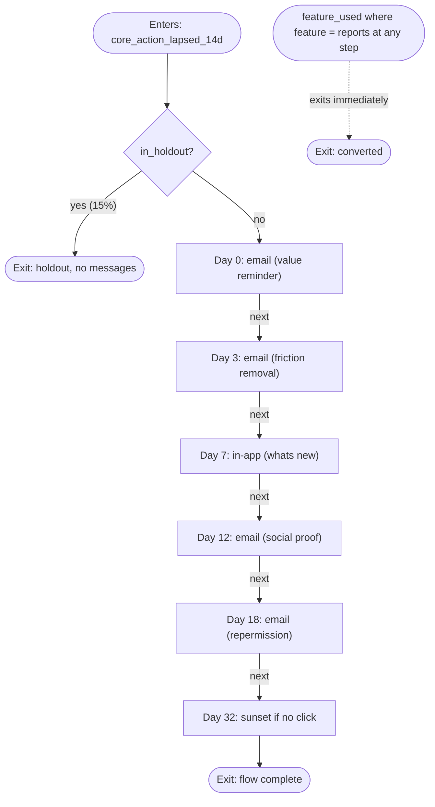

# Win-back: Ridgeview, 14 days since the core action (created a report)

**Status: READY WITH ASSUMPTIONS** | Customer.io | generated 2026-10-21T01:16:19+00:00 | run 6617aa32ca00 | LMM Engine 2.2.0

## In one paragraph

People who completed onboarding and then went 14 days without the core action (created a report). They enter on day 14, once per lapse, and leave the moment they do the core action again. The flow sends up to 5 message(s) over 18 days (email, in-app), starts with a 15% holdout that receives nothing, and stops the moment they create a report again. About 28 people a month (DEMO DATA) would enter; 17.5% come back within 30 days on their own (DEMO DATA). Read: directional only. GREEN gate: normal sending within the frequency cap.

## Confirm before you build

- **monthly_entrants**: estimated from the data (DEMO DATA): 28 a month, mean threshold crossings over 3 complete month(s) to 2026-09
- **baseline_conversion_rate**: estimated from the data (DEMO DATA): 17.5%, 22 of 126 matured threshold crossings came back within 30 days with no flow
- **outcome_window_days**: not stated; set to 30 days so the whole flow (last touch on day 18) plus a week is inside it
- **copy: t2_email**: 2 variant(s) pass lint and guardrails (offline); contains [bracketed] fill-ins: replace them with the real specifics before sending
- **copy: t3_in_app**: 2 variant(s) pass lint and guardrails (offline); contains [bracketed] fill-ins: replace them with the real specifics before sending
- **copy: t4_email**: 2 variant(s) pass lint and guardrails (offline); contains [bracketed] fill-ins: replace them with the real specifics before sending
- **holdout read**: directional only: not inside 12 months at this volume (it would take about 187 months): keep the holdout, report against a pre/post baseline, and label every result directional
- **compliance: one-click unsubscribe and complaint rate**: mailbox providers: Gmail and Yahoo require bulk senders' marketing mail to carry one-click unsubscribe (RFC 8058) plus a visible unsubscribe link, honored within two days, and to keep user-reported spam under 0.3% (Gmail's target is under 0.1%). One-click unsubscribe is a header your platform adds: confirm it is on (tools/deliverability.py checks it in real headers).
- **compliance: bulk-sender authentication**: mailbox providers: Gmail, Yahoo and Microsoft (Outlook.com, Hotmail.com and Live.com since 5 May 2025) require senders of more than 5,000 messages a day to pass SPF and DKIM and publish DMARC (p=none or stricter) aligned with one of them; Microsoft sends failing mail to junk, then rejects it with 550 5.7.515. Run lcm "check deliverability for <your sending domain>" (tools/dns_collect.py) and resolve anything RED before launch.
- **compliance: CAN-SPAM ad identification**: United States: A commercial message must be identified as an advertisement unless the recipient gave prior affirmative consent to receive it. Confirm every recipient opted in to marketing email, or add a clear advertisement disclosure.
- **compliance: CASL consent**: Canada: Commercial electronic messages need express or implied consent. Every email requires a consent record; 86% of records carry a consent timestamp. Implied consent expires: two years after a purchase, six months after an inquiry or application. Exclude Canadian records whose implied consent has lapsed, or confirm they gave express consent.
- **compliance: PECR consent or soft opt-in**: United Kingdom: Marketing email to individuals needs specific consent, or the soft opt-in for people who bought or negotiated to buy a similar product and were offered an opt-out at collection and in every message. The ICO is revising this guidance after the Data (Use and Access) Act. Every email requires a consent record; 86% of records carry a consent timestamp. Confirm each UK record has consent or qualifies for the soft opt-in.
- **compliance: ePrivacy consent**: European Union: Marketing email needs prior consent, except to existing customers for similar products with an opt-out at collection and in every message (ePrivacy Directive, article 13). Every email requires a consent record; 86% of records carry a consent timestamp. Confirm the lawful basis for each EU record and that consent records can be produced.
- **compliance: double opt-in evidence**: Germany: UWG section 7 requires prior express consent for marketing email; the Federal Court of Justice (I ZR 164/09) puts the burden of proof on the sender, which in practice means a stored double opt-in confirmation per person. Confirm German records were collected with double opt-in and that each confirmation is stored.
- **compliance**: 16 rule(s) checked for Australia, Canada, Germany, European Union, United Kingdom, United States

## Why the plan looks like this

| Agent | Decision | Why |
|---|---|---|
| intake | sending gate GREEN | GREEN gate: normal sending within the frequency cap |
| analyst | entry rule | People who completed onboarding and then went 14 days without the core action (created a report). They enter on day 14, once per lapse, and leave the moment they do the core action again. |
| strategist | end with re-permission and a sunset | people who ignore a whole win-back flow are the ones who complain; asking and then stopping protects the sender |
| strategist | offer stance | no offer anywhere in the flow (offer policy) |
| experiment | 15% persistent holdout, read: directional only | not inside 12 months at this volume (it would take about 187 months): keep the holdout, report against a pre/post baseline, and label every result directional |
| compliance | compliance warn | jurisdictions in the audience: Australia, Canada, Germany, European Union, United Kingdom, United States |

## Who enters

| | |
|---|---|
| Entry | completed onboarding (onboarding_step_completed where step_index = 3) at least once (evaluated at entry); 14 or more calendar days since the core action (feature_used where feature = reports), counted from their own last one, or from qualifying if they never did it; queued on the first daily run after crossing (a missed run catches up for 3 days) and pushed from the ledger lcm_flow_entries, which holds each lapse once |
| Never enters | no consent for any channel in the flow; on the platform's suppression list; internal or test account |
| Exit | leaves the moment they create a report again (checked before every step) |
| Trigger | core_action_lapsed_14d: Event-triggered campaign on core_action_lapsed_14d, re-entry allowed. Exit: performs feature_used where feature = reports (conversion goal with exit on conversion). Holdout: True/False branch on the event attribute in_holdout. |
| Monthly entrants | 28 (DEMO DATA: mean threshold crossings over 3 complete month(s) to 2026-09) |
| Come back with no flow | 17.5% (DEMO DATA: 22 of 126 matured threshold crossings came back within 30 days with no flow) |
| Entering on 2026-10-18 | 3 |

| Data dependency | Kind | Status | Fill | Note |
|---|---|---|---|---|
| onboarding_step_completed (step_index=3) | event | verified | 100% | qualifies a person for the flow; 708 events from 324 people; property step_index filled on 100% of events, 158 match 3 |
| feature_used (feature=reports) | event | verified | 100% | the core action: entry clock, exit and primary metric; 915 events from 209 people; property feature filled on 100% of events, 242 match reports |
| email | attribute | verified | 100% | address for every email touch; users.email filled 100% |
| email_consent | attribute | verified | 86% | email marketing consent; users.email_consent_at filled 86% |
| session_started | event | verified |  | in-app messages show at the next session |
| in_holdout | attribute | unknown |  | set by the daily entry job on the pushed event; schedule the job before launch |
| lcm_flow_entries | object | unknown |  | the ledger (outbox) of entries; create it once with cohort/job/ledger_<dialect>.sql |
| lcm_sunset | attribute | unknown |  | suppression flag the sunset step writes; create the property in the platform before launch |

The daily job (postgres), in `cohort/job/`: create the ledger once (`ledger_postgres.sql`); then each day queue who is due (`queue_postgres.sql`), push every pending row (`pending_postgres.sql` into tools/event_payloads.py), and after each request succeeds mark the rows it carried (`mark_postgres.sql`, one row at a time). Each lapse sits in the ledger once, so nobody enters twice; a failed push stays pending and goes out on the next run. `cohort/entry_postgres.sql` shows who is due without queuing; other dialects and the history query are in `cohort/`.

## The flow

| Day | Step | Channel | Job | Only if |
|---:|---|---|---|---|
| 0 | t1_email | email | Remind them of the one outcome Ridgeview gave them, tied to what they last did, with one link that lets them create a report again. No offer. |  |
| 3 | t2_email | email | Name the most common reason people stop at this point and remove it: a template, a two-minute path, or a reply to a person. |  |
| 7 | t3_in_app | in-app | One change in Ridgeview since they were last active that makes it easier to create a report. Show it; do not list features. |  |
| 12 | t4_email | email | How a team like theirs uses Ridgeview to create a report each week: one specific, true example with a number. |  |
| 18 | t5_email | email | Ask plainly whether they still want these messages, with one button to stay. Say what happens if they do nothing. |  |

Every step: has not done feature_used where feature = reports since entering; can receive email marketing (subscribed, not bounced, not sunset-suppressed). Frequency: at most 3 lifecycle messages a person a week across flows (the workspace message limit); send at 10:00 recipient local; nothing between 21:00 to 08:00 recipient local time.

| Touch | Why this job and channel |
|---|---|
| 1. day 0, value reminder, email | opens on what they already got from the product: the cheapest reason to come back; email carries the long-form message, the unsubscribe and the fallback for every other channel |
| 2. day 3, friction removal, email | the most common reason people stop is a specific obstacle; naming and removing it beats a generic nudge; email carries the long-form message, the unsubscribe and the fallback for every other channel |
| 3. day 7, whats new, in-app | a lapsed user's picture of the product is out of date; one concrete change updates it; in-app waits for the next session, so it only reaches people already back, and expires after three days |
| 4. day 12, social proof, email | a routine copied from a similar team lowers the effort of deciding what to do; email carries the long-form message, the unsubscribe and the fallback for every other channel |
| 5. day 18, repermission, email | ends honestly: asks whether to keep mailing, which protects the sender reputation every other flow depends on; email carries the long-form message, the unsubscribe and the fallback for every other channel |

## Build it in Customer.io

1. Create the ledger once (cohort/job/ledger_postgres.sql). Then schedule the daily job after the warehouse load: run cohort/job/queue_postgres.sql; read the rows from cohort/job/pending_postgres.sql and send one core_action_lapsed_14d event per row with tools/event_payloads.py (customerio), holdout members included; after each request succeeds, run cohort/job/mark_postgres.sql for every row it carried. Rows whose request failed stay pending and go out on the next run. Do not push from cohort/entry_postgres.sql: it does not write the ledger, so the same lapse would go out on several days.
2. Create an event-triggered campaign and leave every message in Draft until it is approved. Trigger: core_action_lapsed_14d.
3. Entry filters (checked once at entry): completed onboarding (onboarding_step_completed where step_index = 3) at least once.
4. Checked before every step (Exit condition (conversion goal, exit on conversion)): has not done feature_used where feature = reports since entering; can receive email marketing (subscribed, not bounced, not sunset-suppressed).
5. First step, True/False branch: in_holdout is true goes to exit; everyone else continues. Nothing sends before this split.
6. Time delay to day 0 at 10:00 recipient local, then email message t1_email: value reminder.
7. Time delay to day 3 at 10:00 recipient local, then email message t2_email: friction removal.
8. Time delay to day 7 at 10:00 recipient local, then in-app message t3_in_app: whats new.
9. Time delay to day 12 at 10:00 recipient local, then email message t4_email: social proof.
10. Time delay to day 18 at 10:00 recipient local, then email message t5_email: repermission.
11. Time delay 14 days, then: if no click on the re-permission email, update the person: lcm_sunset = true. Make lcm_sunset a suppression in every marketing send.
12. Frequency: at most 3 lifecycle messages a person a week across flows (the workspace message limit); send at 10:00 recipient local; nothing between 21:00 to 08:00 recipient local time.
13. Before enabling: run scripts/campaign_simulator.py on flow_spec.json, send every message to a seed list, and get approval. Exit on feature_used where feature = reports must be live before the first send.

## The copy

### t1_email (email, offline)

| Variant | Copy | Framework | Hypothesis |
|---|---|---|---|
| A | **Your Ridgeview workspace is where you left it** / Pick up from your last session in Ridgeview | BAB: before, after, bridge | Stressing that setup is already done raises the core-action rate within 7 days because it removes the restart cost; falsified if B converts as well or better. |
| B | **14 days since you last created a report** / A plain note, no offer | Plain, factual reminder | A factual, specific gap in the subject raises clicks more than a benefit line because it is concrete; falsified if A's click rate is equal or higher. |

Files: `copy/t1_email_A.html`, `copy/t1_email_A.subject.txt`, `copy/t1_email_A.txt`, `copy/t1_email_B.html`, `copy/t1_email_B.subject.txt`, `copy/t1_email_B.txt`

### t2_email (email, offline)

| Variant | Copy | Framework | Hypothesis |
|---|---|---|---|
| A | **The step most people get stuck on** / And the two-minute way past it | PAS: problem, agitation kept factual, solution | Naming the blocker raises the core-action rate among lapsed users because it addresses the actual reason they left; falsified if B converts as well or better. |
| B | **A template to create a report in two minutes** / Start from something that already works | Solution first, problem implied | Leading with a ready-made starting point raises the core-action rate more than naming the problem because it lowers effort at the moment of reading; falsified if A converts as well or better. |

Files: `copy/t2_email_A.html`, `copy/t2_email_A.subject.txt`, `copy/t2_email_A.txt`, `copy/t2_email_B.html`, `copy/t2_email_B.subject.txt`, `copy/t2_email_B.txt`

### t3_in_app (in-app, offline)

| Variant | Copy | Framework | Hypothesis |
|---|---|---|---|
| A | **One thing changed** / [What the change does for them, with a concrete example]. [See it] | AIDA: attention, interest, desire, action | A single concrete change raises clicks more than a roundup because it is easy to evaluate; falsified if B's click rate is equal or higher. |
| B | **[The change, as a benefit]** / It came from requests like yours. Try it on your own data. [Try it now] | Reciprocity framed around feedback | Framing the change as a response to customer requests raises clicks because it signals the product is improving for them; falsified if A's click rate is equal or higher. |

Files: `copy/t3_in_app_A.json`, `copy/t3_in_app_B.json`

### t4_email (email, offline)

| Variant | Copy | Framework | Hypothesis |
|---|---|---|---|
| A | **How [customer type] use Ridgeview each week** / One routine, start to finish | Social proof through one concrete case | A single specific customer routine raises the core-action rate more than general benefits because it is easy to imitate; falsified if B converts as well or better. |
| B | **[Number] teams did this last week** / A quick look at what is working | Social proof through volume | A volume number raises clicks less than one concrete case; falsified if B's click rate is higher than A's. |

Files: `copy/t4_email_A.html`, `copy/t4_email_A.subject.txt`, `copy/t4_email_A.txt`, `copy/t4_email_B.html`, `copy/t4_email_B.subject.txt`, `copy/t4_email_B.txt`

### t5_email (email, offline)

| Variant | Copy | Framework | Hypothesis |
|---|---|---|---|
| A | **Should we keep sending these?** / One click to stay; nothing to do to stop | Plain re-permission; no guilt, no countdown | An honest ask keeps the people who still care and lowers complaints from those who do not; expect 1 to 5% to click. Falsified if complaints on this send exceed the flow average. |
| B | **We will pause emails from Ridgeview** / Unless you tell us otherwise | Default-effect framing | Stating the default (a pause) raises stay clicks over asking a question because it makes the consequence concrete; falsified if A's stay rate is equal or higher. |

Files: `copy/t5_email_A.html`, `copy/t5_email_A.subject.txt`, `copy/t5_email_A.txt`, `copy/t5_email_B.html`, `copy/t5_email_B.subject.txt`, `copy/t5_email_B.txt`

## Measurement

| | |
|---|---|
| Holdout | 15%, user level, persistent: persistent, by user: bucket = first 7 hex digits of md5(user_id || ':ridgeview_winback_14d') mod 100; bucket < 15 is the holdout, computed in the daily queue query and pushed on the trigger event as in_holdout; holdout members enter, then exit at holdout_split, so both arms are the same population |
| Primary metric | created a report (feature_used where feature = reports) within 30 days of entry, treatment vs holdout, both arms counted from their entry date |
| Sizing | about 28 entrants a month (DEMO DATA), 17.5% return within 30 days with no flow (DEMO DATA), 25% relative lift (4.4 pts) worth acting on: 781 holdout entrants at 15%, 186.0 months of entries plus the 30-day outcome window, so the read lands about 186.9 months after launch (tools/stats.py feasible --entries-per-month 28 --holdout 0.15 --baseline 0.1746 --mde-rel 0.25 --outcome-window-days 30) |
| Read | directional only: not inside 12 months at this volume (it would take about 187 months): keep the holdout, report against a pre/post baseline, and label every result directional |
| Decision rule | Keep the flow when the 95% interval for (treatment minus holdout) rate of feature_used where feature = reports lies above zero and the guardrails hold. If it spans zero at the planned read, report it as inconclusive: keep the holdout running or change the flow. Report attributed, incremental and the gap together (tools/stats.py incrementality). |
| Sample ratio | At every look, test the split against 85/15 (tools/stats.py readout --expected-holdout 0.15). A chi-square p below 0.001 means assignment or logging is broken; read nothing until it is fixed. |
| Peeking | One planned read on the date above. Earlier looks check sample ratio and guardrails only; no early stop for a good-looking lift. |
| Guardrails | spam complaint rate per send below 0.1% (Gmail's target; 0.3% is its hard limit); unsubscribe rate per send, against the 90-day median for your lifecycle sends; pause a touch running above twice it; hard bounce rate below 1% |
| Copy tests | Copy variants rotate evenly inside the treatment arm. Read them on clicks or the core action, never opens, and only directionally below about 1,000 sends per variant (size exactly with tools/stats.py size --baseline <click rate> --mde-rel 0.2) |

| Months of entries | Holdout n | Treatment n | Smallest detectable lift |
|---:|---:|---:|---|
| 3 | 12 | 71 | 41.0 pts (235% relative) |
| 6 | 25 | 142 | 28.24 pts (162% relative) |
| 12 | 50 | 285 | 19.35 pts (111% relative) |

## Deliverability guardrails

- Gate: GREEN gate: normal sending within the frequency cap. Audience: every entrant with consent for the channel.
- Suppressed: unsubscribed from marketing email, or hard bounced
- Suppressed: marked any message as spam (complaint), ever
- Suppressed: sunset-suppressed (lcm_sunset is true); only a fresh opt-in lifts it
- Suppressed: internal, test and seed addresses
- Suppressed: currently in a higher-priority flow (transactional, billing, post-purchase)
- Suppressed: received a re-permission ask from any flow in the last 180 days
- One re-permission ask per person per 180 days, across all flows.
- No click on the re-permission ask within 14 days: set lcm_sunset = true and stop marketing mail. Keep the record; never delete it.
- A sunset-suppressed person re-enters only through an explicit opt-in action, never through a flow.
- Hard bounces are never mailed again; complaints are suppressed permanently.
- Unsubscribes, including one-click (RFC 8058), are honored within 2 days on every platform the person is on.
- On an AMBER gate, win-back entrants are limited to people who clicked or replied in the last 90 days.
- Every email carries the platform's unsubscribe token and a postal address; every SMS carries opt-out language; every template is linted in its dialect; image-only email is blocked.

## Compliance

**WARN** for Australia, Canada, Germany, European Union, United Kingdom, United States. Rules engine, not legal advice: it checks the plan against the rules in config/compliance_rules.json, each with its source. Confirm anything marked warn with counsel.

| Rule | Jurisdiction | Result | Detail | Source |
|---|---|---|---|---|
| one-click unsubscribe and complaint rate | mailbox providers | WARN | Gmail and Yahoo require bulk senders' marketing mail to carry one-click unsubscribe (RFC 8058) plus a visible unsubscribe link, honored within two days, and to keep user-reported spam under 0.3% (Gmail's target is under 0.1%). One-click unsubscribe is a header your platform adds: confirm it is on (tools/deliverability.py checks it in real headers). | https://support.google.com/mail/answer/81126 |
| bulk-sender authentication | mailbox providers | WARN | Gmail, Yahoo and Microsoft (Outlook.com, Hotmail.com and Live.com since 5 May 2025) require senders of more than 5,000 messages a day to pass SPF and DKIM and publish DMARC (p=none or stricter) aligned with one of them; Microsoft sends failing mail to junk, then rejects it with 550 5.7.515. Run lcm "check deliverability for <your sending domain>" (tools/dns_collect.py) and resolve anything RED before launch. | https://support.google.com/mail/answer/81126 |
| suppression of opt-outs, bounces and complaints | mailbox providers | PASS | Never mail people who unsubscribed, hard bounced or complained. Unsubscribes, hard bounces and spam complaints are suppressed in every step. | https://support.google.com/mail/answer/81126 |
| CAN-SPAM postal address | United States | PASS | Commercial email must include the sender's valid physical postal address (a registered PO box or private mailbox counts). A postal address or the platform's address token is in all 8 emails. | https://www.ftc.gov/business-guidance/resources/can-spam-act-compliance-guide-business |
| CAN-SPAM opt-out | United States | PASS | Commercial email must offer a clear way to opt out that keeps working for at least 30 days after the send, honored within 10 business days. Every email carries the platform's unsubscribe link. Honoring requests within 10 business days is a process requirement on your platform: confirm it. | https://www.ftc.gov/business-guidance/resources/can-spam-act-compliance-guide-business |
| CAN-SPAM honest subject and header | United States | PASS | Subject lines and header information must not mislead. No subject implies a prior conversation; the guardrails also block fake urgency and offers outside policy. | https://www.ftc.gov/business-guidance/resources/can-spam-act-compliance-guide-business |
| CAN-SPAM ad identification | United States | WARN | A commercial message must be identified as an advertisement unless the recipient gave prior affirmative consent to receive it. Confirm every recipient opted in to marketing email, or add a clear advertisement disclosure. | https://www.ftc.gov/business-guidance/resources/can-spam-act-compliance-guide-business |
| CASL consent | Canada | WARN | Commercial electronic messages need express or implied consent. Every email requires a consent record; 86% of records carry a consent timestamp. Implied consent expires: two years after a purchase, six months after an inquiry or application. Exclude Canadian records whose implied consent has lapsed, or confirm they gave express consent. | https://ised-isde.canada.ca/site/canada-anti-spam-legislation/en/node/7 |
| CASL identification and unsubscribe | Canada | PASS | Messages must identify the sender, give contact information and a no-cost unsubscribe mechanism, honored within 10 business days. Every email carries the platform's unsubscribe link. Honoring requests within 10 business days is a process requirement on your platform: confirm it. | https://ised-isde.canada.ca/site/canada-anti-spam-legislation/en/node/7 |
| CASL sender identification | Canada | PASS | Every message identifies who sent it and on whose behalf, with a mailing address and a phone number, email or web address that stays valid for 60 days. Every email footer names the sender and every SMS starts with the brand name. | https://ised-isde.canada.ca/site/canada-anti-spam-legislation/en/node/7 |
| PECR consent or soft opt-in | United Kingdom | WARN | Marketing email to individuals needs specific consent, or the soft opt-in for people who bought or negotiated to buy a similar product and were offered an opt-out at collection and in every message. The ICO is revising this guidance after the Data (Use and Access) Act. Every email requires a consent record; 86% of records carry a consent timestamp. Confirm each UK record has consent or qualifies for the soft opt-in. | https://ico.org.uk/for-organisations/direct-marketing-and-privacy-and-electronic-communications/guide-to-pecr/electronic-and-telephone-marketing/electronic-mail-marketing/ |
| ePrivacy consent | European Union | WARN | Marketing email needs prior consent, except to existing customers for similar products with an opt-out at collection and in every message (ePrivacy Directive, article 13). Every email requires a consent record; 86% of records carry a consent timestamp. Confirm the lawful basis for each EU record and that consent records can be produced. | https://eur-lex.europa.eu/legal-content/EN/TXT/?uri=CELEX:32002L0058 |
| EU unsubscribe in every message | European Union | PASS | Every marketing message offers a free, easy opt-out. Every email carries the platform's unsubscribe link. | https://eur-lex.europa.eu/legal-content/EN/TXT/?uri=CELEX:32002L0058 |
| double opt-in evidence | Germany | WARN | UWG section 7 requires prior express consent for marketing email; the Federal Court of Justice (I ZR 164/09) puts the burden of proof on the sender, which in practice means a stored double opt-in confirmation per person. Confirm German records were collected with double opt-in and that each confirmation is stored. | https://www.gesetze-im-internet.de/uwg_2004/__7.html |
| Spam Act consent, identification and unsubscribe | Australia | PASS | Commercial messages need consent, must identify the sender and offer a functional unsubscribe that keeps working for 30 days after the send, honored within 5 working days. Every email carries the platform's unsubscribe link. Honoring requests within 5 working days is a process requirement on your platform: confirm it. | https://www.acma.gov.au/avoid-sending-spam |
| Spam Act sender identification | Australia | PASS | Every message identifies the business that authorized it. Every email footer names the sender and every SMS starts with the brand name. | https://www.acma.gov.au/avoid-sending-spam |

## QA

| Check | Result | Detail |
|---|---|---|
| sending gate | PASS | GREEN gate: normal sending within the frequency cap |
| data dependencies | PASS | every event and attribute the flow needs is present |
| cohort SQL | PASS | every generated query parses in postgres, snowflake and bigquery; entry query ran on the data |
| simulation: flow spec matches schemas/flow_spec.schema.json | PASS | valid |
| simulation: step ids are unique | PASS | unique |
| simulation: every branch target is a step or an exit | PASS | all resolve |
| simulation: every step is reachable | PASS | all reachable |
| simulation: holdout is held out before the first message | PASS | holdout_split at position 1 |
| simulation: exit on goal is immediate | PASS | goal: created a report (feature_used where feature = reports) |
| simulation: nominal schedule respects the weekly frequency cap | PASS | at most 2 email/sms/push message(s) in any 7 days on any route, cap 3 |
| simulation: journey length | PASS | 5 touch(es) over 18 days on the longest route |
| simulation: holdout members receive nothing | PASS | outcome: exit (holdout), 0 message(s) |
| simulation: no message without consent | PASS | 0 message(s) to a person with no consent |
| simulation: every send matches a consent | PASS | all matched |
| simulation: nothing is sent after the core action | PASS | outcome: converted; 0 message(s) after converting |
| simulation: frequency cap holds for every persona | PASS | most in any 7 days: 2, cap 3 |
| simulation: messages send at 10:00 local | PASS | all on time |
| simulation: nothing sends in quiet hours | PASS | none |
| simulation: no persona gets more than the touch count | PASS | max 5 |
| simulation: sunset applies only to people who did not click | PASS | non-clicker sunset: True; clicker sunset: False |
| simulation: no journey loops | PASS | none |
| trigger payload (customerio_pipelines_track) | PASS | valid against config/esp_payload_schemas.json |
| copy: t1_email | PASS | 2 variant(s) pass lint and guardrails (offline) |
| copy: t2_email | WARN | 2 variant(s) pass lint and guardrails (offline); contains [bracketed] fill-ins: replace them with the real specifics before sending |
| copy: t3_in_app | WARN | 2 variant(s) pass lint and guardrails (offline); contains [bracketed] fill-ins: replace them with the real specifics before sending |
| copy: t4_email | WARN | 2 variant(s) pass lint and guardrails (offline); contains [bracketed] fill-ins: replace them with the real specifics before sending |
| copy: t5_email | PASS | 2 variant(s) pass lint and guardrails (offline) |
| holdout read | WARN | directional only: not inside 12 months at this volume (it would take about 187 months): keep the holdout, report against a pre/post baseline, and label every result directional |
| compliance: one-click unsubscribe and complaint rate | WARN | mailbox providers: Gmail and Yahoo require bulk senders' marketing mail to carry one-click unsubscribe (RFC 8058) plus a visible unsubscribe link, honored within two days, and to keep user-reported spam under 0.3% (Gmail's target is under 0.1%). One-click unsubscribe is a header your platform adds: confirm it is on (tools/deliverability.py checks it in real headers). |
| compliance: bulk-sender authentication | WARN | mailbox providers: Gmail, Yahoo and Microsoft (Outlook.com, Hotmail.com and Live.com since 5 May 2025) require senders of more than 5,000 messages a day to pass SPF and DKIM and publish DMARC (p=none or stricter) aligned with one of them; Microsoft sends failing mail to junk, then rejects it with 550 5.7.515. Run lcm "check deliverability for <your sending domain>" (tools/dns_collect.py) and resolve anything RED before launch. |
| compliance: CAN-SPAM ad identification | WARN | United States: A commercial message must be identified as an advertisement unless the recipient gave prior affirmative consent to receive it. Confirm every recipient opted in to marketing email, or add a clear advertisement disclosure. |
| compliance: CASL consent | WARN | Canada: Commercial electronic messages need express or implied consent. Every email requires a consent record; 86% of records carry a consent timestamp. Implied consent expires: two years after a purchase, six months after an inquiry or application. Exclude Canadian records whose implied consent has lapsed, or confirm they gave express consent. |
| compliance: PECR consent or soft opt-in | WARN | United Kingdom: Marketing email to individuals needs specific consent, or the soft opt-in for people who bought or negotiated to buy a similar product and were offered an opt-out at collection and in every message. The ICO is revising this guidance after the Data (Use and Access) Act. Every email requires a consent record; 86% of records carry a consent timestamp. Confirm each UK record has consent or qualifies for the soft opt-in. |
| compliance: ePrivacy consent | WARN | European Union: Marketing email needs prior consent, except to existing customers for similar products with an opt-out at collection and in every message (ePrivacy Directive, article 13). Every email requires a consent record; 86% of records carry a consent timestamp. Confirm the lawful basis for each EU record and that consent records can be produced. |
| compliance: double opt-in evidence | WARN | Germany: UWG section 7 requires prior express consent for marketing email; the Federal Court of Justice (I ZR 164/09) puts the burden of proof on the sender, which in practice means a stored double opt-in confirmation per person. Confirm German records were collected with double opt-in and that each confirmation is stored. |
| compliance | WARN | 16 rule(s) checked for Australia, Canada, Germany, European Union, United Kingdom, United States |

## Files

- `flow_spec.json`: the flow, valid against `schemas/flow_spec.schema.json`
- `simulation.json`: rules for `python3 scripts/campaign_simulator.py flow_spec.json`
- `cohort/`: entry and history SQL for postgres, snowflake, bigquery and duckdb
- `copy/`: rendered templates; `experiment.json`; `trigger_payload_example.json`; `plan.json` (everything)
